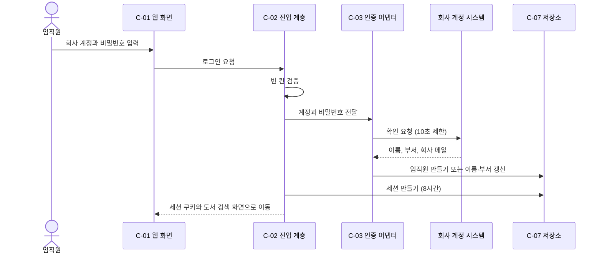
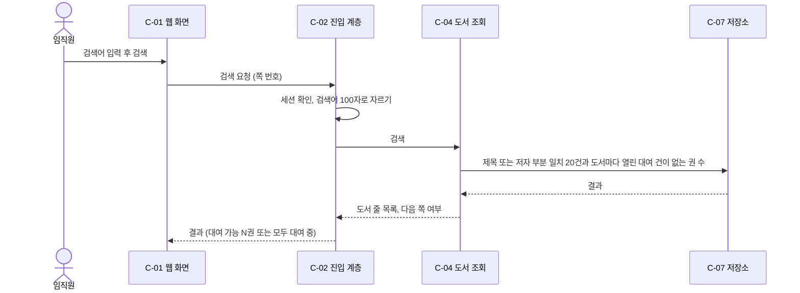
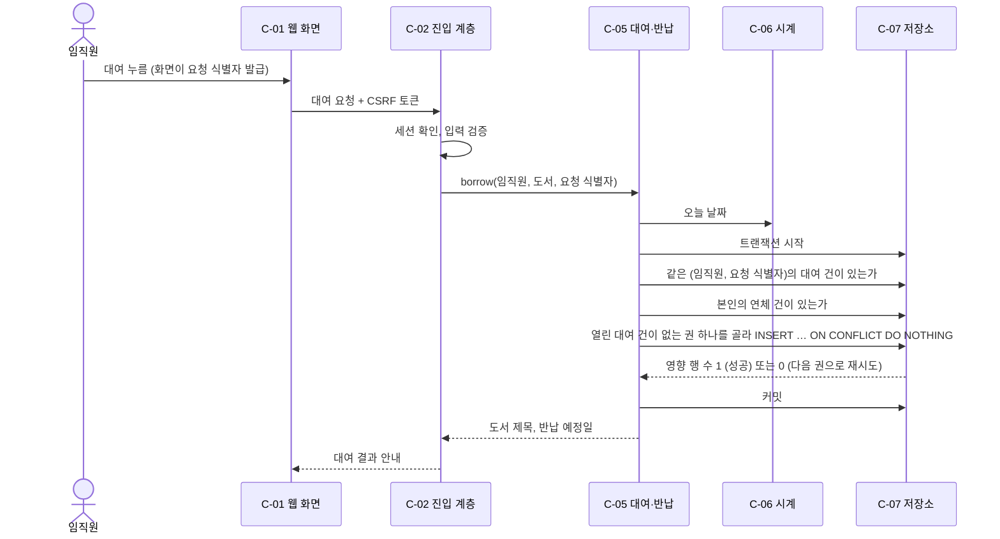
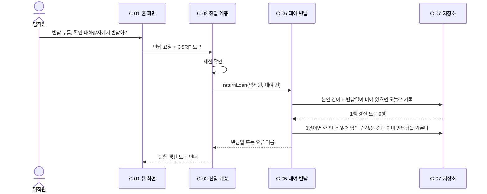

# 사내 도서 대여 서비스 아키텍처

용어는 `plan/glossary.md` 를 따른다. 기능·스토리·비기능 요구는 `plan/requirements.md`, 화면은 `plan/ui-spec.md` 를 가리킨다.

## 1. 쉬운 말 요약

사내 서버 한 대에 서비스 하나와 데이터 보관소 하나를 두는 단순한 구조로 만든다. 임직원은 사내망의 웹에서 회사 계정으로 들어와 도서를 찾고 빌리고 반납한다. 비밀번호는 회사 계정 시스템에 전달해 확인만 하고 어디에도 남기지 않는다. 한 권이 두 사람에게 동시에 나가거나 반쯤 처리된 대여가 남는 일이 없도록, 「대여 중」이라는 표시를 따로 저장하지 않고 대여 기록 그 자체로 판단한다. 남은 위험은 두 가지다. 회사 계정 시스템이 회사 메일을 돌려주는지, 그리고 동시에 빌릴 때 한 권만 나가는지는 문서로 확인할 수 없어 구현 첫 단계에서 실험한다.

## 2. 지금 구조

기존 구조 없음. 레포에는 `README.md` 하나뿐이고 소스·설정·마이그레이션·테스트가 없다(근거: `README.md`, `plan/ui-spec.md#1. 개요`). 모든 구성 요소는 신규이며 따를 기존 관례도 없다.

## 3. 구성 요소

「핵심」은 이 서비스의 규칙과 위험이 모여 있어 가장 깊게 설계한 모듈이다. 「S4 시험 경계 후보」는 S4 가 시험 경계(테스트 seam)로 삼을 만한 인터페이스다.

| id | 이름 | 책임 | 신규/기존/변경 | 레포 위치 | 관련 F-·SCR- |
|---|---|---|---|---|---|
| C-01 | 웹 화면 | 로그인·검색·도서 상세·내 대여 현황·반납 확인·오류 안내 화면을 모바일 360px 이상에서 보여 주고 공통 상단 바를 둔다 | 신규 | 미정(S4 가 정함 — 레포에 소스 없음) | F-01, F-04, F-05, F-06, F-07, F-08, F-09, F-10 / SCR-01~06, SCR-08 |
| C-02 | 서비스 진입 계층 | 모든 요청에서 세션을 확인하고 대여 건 접근을 세션의 임직원으로 제한하며 입력을 검증하고 오류 이름을 화면 문구로 바꾼다. 모든 API 가 쓰는 오류 응답 형식과 오류 코드 전체 목록(C-05 의 7종 + 인증 실패·인증 무응답·입력 검증 실패·세션 만료·CSRF 거부·UNAVAILABLE)을 한 번 정의하고, 입력 검증 규칙의 정본 위치를 하나로 두어 서버와 화면이 같이 쓴다. S4 에서 API 명세를 먼저 쓰고 그 명세에서 오류 코드와 검증 규칙을 가져온다 | 신규 | 미정(S4) | F-01, F-07, F-10 / SCR-01~06, SCR-08 |
| C-03 | 회사 계정 인증 어댑터 | 로그인 화면에서 받은 비밀번호를 회사 계정 시스템에 전달만 하고 돌려받은 이름·부서·회사 메일로 임직원을 만들거나 갱신하며 10초 안에 응답이 없으면 실패로 본다 (S4 시험 경계 후보) | 신규 | 미정(S4) | F-01, F-02, F-03 / SCR-01 |
| C-04 | 도서 조회 모듈 | 제목·저자 검색(20건씩 쪽 나눔)과 도서 상세를 돌려주고 대여 가능 권수를 열린 대여 건이 없는 권을 세어 계산한다 (S4 시험 경계 후보) | 신규 | 미정(S4) | F-04, F-05, F-06 / SCR-02, SCR-03, SCR-06 |
| C-05 | 대여·반납 모듈 (핵심) | 대여·반납·내 대여 현황의 규칙(연체 거절, 요청 식별자 멱등, 소유 확인, 14일 기간)을 인터페이스 3개 뒤에 모아 한 트랜잭션으로 처리한다 (S4 시험 경계 후보) | 신규 | 미정(S4) | F-07, F-08, F-09, F-10, F-14 / SCR-03, SCR-04, SCR-05, SCR-08 |
| C-06 | 시계 | 오늘의 한국 표준시 날짜를 돌려주며 운영용과 고정용 어댑터 둘을 갖는다 | 신규 | 미정(S4) | F-07, F-09, F-10 / SCR-03, SCR-04 |
| C-07 | 데이터 저장소 | 임직원·도서·권·대여 건·세션을 PostgreSQL 한 개에 보관하고 한 권에 열린 대여 건이 둘이 되지 못하게 막는다 | 신규 | 미정(S4 가 데이터 모델 확정) | F-01, F-03, F-04~F-10, F-14 |
| C-08 | 기록 보관 정리 작업 | 매일 1회 반납일이 5년 지난 대여 건과 만료된 세션 행을 삭제하고, 대여 건이 하나도 없고 유효한 세션도 없는 임직원 행도 함께 삭제한다. 실행 방식은 OS 스케줄러(매일 1회)이고 재실행해도 결과가 같으며, 실패하면 다음 날 다시 돌고 로그에 남는다 | 신규 | 미정(S4) | F-14 |
| C-09 | 초기 적재 도구 | 개발팀이 도서·권을 한 번 넣고 이후 변경 요청도 처리하며 대여 중인 권은 지우지 않는다 | 신규 | 미정(S4) | 기능 없음(요구사항 A-26·A-30 의 운영 수단) |

- F-11~F-13(관리자 도서 등록·연체 목록·연체 메일)은 2차라 이 문서의 범위 밖이다(`plan/requirements.md#F-11`). 2차 붙임 방식은 7절 S3-D1 에 적었다.
- F-03 은 화면이 없고 C-03(받는 값을 제한)과 C-07(저장하는 값을 제한)이 지킨다(`plan/ui-spec.md#1. 개요`).

### 3.1 C-05 의 인터페이스

| 연산 | 입력 | 성공 출력 |
|---|---|---|
| `borrow` | 임직원(회사 메일), 도서 id, 요청 식별자 | 대여 id, 도서 제목, 반납 예정일, 재전송 여부 |
| `returnLoan` | 임직원, 대여 건 id | 대여 id, 반납일 |
| `myLoans` | 임직원 | 건마다 대여 id·도서 제목·반납 예정일·연체 여부, 전체 연체 여부(반납 예정일 빠른 순, 같은 날이면 먼저 빌린 순) |

오류 7종(닫힌 목록, 호출자는 이름만 보고 문구를 고른다. 근거: `work/core-design-A.md#1. 인터페이스`):

| 오류 | 언제 | 화면 |
|---|---|---|
| `OVERDUE_BLOCKED` | 대여 때 본인에게 연체 건이 있다 | SCR-03 연체 거절과 「내 대여 현황으로」 |
| `NO_COPY_AVAILABLE` | 대여 가능 권이 없다(마지막 권을 먼저 빌려 간 경우 포함) | SCR-03 「방금 모든 권이 대여 중」 |
| `BOOK_NOT_FOUND` | 도서 id 가 없다 | SCR-06 |
| `FORBIDDEN` | 남의 대여 건이거나 없는 대여 건(존재를 알리지 않는다) | SCR-08 |
| `ALREADY_RETURNED` | 내 건인데 이미 반납됨(중복 처리 안 함) | SCR-04 상단 안내 |
| `REQUEST_ID_CONFLICT` | 같은 사람이 같은 요청 식별자로 다른 도서를 요청함(다른 사람의 같은 식별자는 서로 다른 요청이라 충돌하지 않고, 남의 건의 응답은 오지 않는다) | 일반 실패 안내 |
| `UNAVAILABLE` | 저장소 오류·시간 초과. 트랜잭션이 전부 되돌려져 아무것도 바뀌지 않았다 | 영역 안 실패 안내 |

### 3.2 핵심 모듈 설계 비교와 삭제 시험

세 설계안을 비교했다(근거: `work/core-design-A.md`, `work/core-design-B.md`, `work/core-design-C.md`).

| 안 | 요지 | 차이점 |
|---|---|---|
| A | 인터페이스 3개. 권 상태 컬럼 없이 열린 대여 건에서 「대여 중」을 유도하고 부분 유일 인덱스(반납일이 비어 있는 건은 권당 1건)로 지킨다 | 상태와 기록이 갈라질 수 없다. 저장소 seam 없음 |
| B | 규칙을 순수 함수 한 파일에 모으고 권 행 잠금을 쓴다. 요청 식별자는 대여 행의 유일 열(전체에서 유일) | 권 상태를 따로 저장해 대여 행과 함께 갱신해야 한다 |
| C | 저장소를 포트로 빼고 메모리 어댑터를 둔다. 읽기 함수가 6개 | 메모리 어댑터는 동시성을 흉내 낼 수 없어 동시성 시험은 결국 실제 DB 가 필요하다 |

**고른 것: A 구조 + A 안의 복합 유일 제약(회사 메일로 구분한 임직원, 요청 식별자)에 B 의 요청 식별자 열 개념을 합침 + 연체·가능 권수는 읽을 때 계산.**

- 권 상태를 저장하지 않으므로 상태와 기록이 어긋날 수 없고, 반쯤 처리된 대여·반납이 구조상 생기지 않는다(`plan/requirements.md#US-08`, `plan/requirements.md#US-11`, `plan/requirements.md#NFR-06`).
- 어댑터가 하나뿐인 저장소 seam 은 만들지 않는다. 시험은 실제 DB 로 돌려 부분 유일 인덱스 동작까지 함께 시험한다.
- 2차 기능은 새 읽기 연산(연체 목록 `listOverdue`)과 시간 기반 작업으로 붙고 대여·반납 흐름 수정이 필요 없다. 대여 연장·예약은 새 연산과 새 상태가 필요하므로 이 모듈 수정이 있음을 인정한다(`plan/requirements.md#7. 범위 밖`).

삭제 시험(지우면 복잡도가 사라지나, 다른 곳에 되살아나나):

| 후보 | 지우면 | 결과 |
|---|---|---|
| C-05 대여·반납 모듈 | 멱등·재시도·연체 판정·날짜 계산·소유 확인이 대여 화면, 현황 화면, 반납 처리 세 곳에 되살아나 서로 어긋날 수 있다 | 유지 |
| C-06 시계 | 날짜 경계(1월 15일은 연체 아님, 16일부터 연체, 평년·윤년)를 시험할 수 없다(`plan/requirements.md#A-25`) | 유지 |
| 권 상태 컬럼 | 지우면 갈라질 수 있는 상태 자체가 사라진다 | 지운 채로 간다 |
| 저장소 인터페이스(포트) | 어댑터가 하나뿐이라 아무것도 되살아나지 않는다 | 만들지 않는다 |
| 대여 이벤트 알림 훅 | 1차에 구독자가 없고 2차 연체 메일은 대여가 아니라 시간 경과로 생긴다 | 만들지 않는다 |
| C-03 인증 어댑터 | 지우면 연동 방식(미정)이 진입 계층 곳곳에 퍼진다 | 유지(가상의 seam 임을 인정 — 아래) |

### 3.3 seam 과 어댑터 수

| seam | 어댑터 | 판단 |
|---|---|---|
| C-06 시계 | 2(운영 시스템 시계, 고정 시계) | 둘 다 실제로 쓰이므로 진짜 seam |
| C-03 회사 계정 인증 | 1(회사 계정 시스템) | 가상의 seam. 연동 방식이 미정이라 교체 지점을 한 곳에 가두고 시험 때 대역을 쓰기 위해 둔다. 외부 시스템이라 시험에서 실제 호출이 불가능하다 |
| C-07 저장소 | seam 없음 | 어댑터가 하나뿐이고 시험도 실제 DB 로 한다 |

S4 의 시험 경계(테스트 seam) 후보: C-05 의 `borrow`·`returnLoan`·`myLoans`, C-04 의 검색·상세, C-03 의 인증 호출. 시험은 이 인터페이스로 하고 내부 함수는 시험 경계로 삼지 않는다.

## 4. 데이터 흐름

### 4.1 US-01 로그인

- 인증 실패는 「계정 또는 비밀번호가 맞지 않음」 한 가지 문구로, 10초 무응답은 「회사 계정 확인을 하지 못함」 문구로 보인다(`plan/ui-spec.md#SCR-01`).
- 회사 메일을 못 받으면 로그인을 허용하지 않고, 이름·부서가 없으면 비워 두고 허용한다(`plan/requirements.md#A-13`).
- 로그인에 쓴 사번과 비밀번호는 인증 전달에만 쓰고 저장·기록하지 않는다(`plan/requirements.md#NFR-03`, `plan/requirements.md#NFR-04`).

### 4.2 US-04 도서 검색

### 4.3 US-07 대여

1. 같은 (회사 메일로 구분한 세션의 임직원, 요청 식별자)의 대여 건이 이미 있으면 같은 도서일 때 첫 결과를 그대로 돌려주고 끝낸다. 같은 사람이 같은 식별자로 다른 도서를 요청하면 `REQUEST_ID_CONFLICT` 다. 다른 사람의 대여 건은 조회 대상이 아니다.
2. 오늘 기준으로 반납일이 비어 있고 반납 예정일이 지난 본인 건이 있으면 `OVERDUE_BLOCKED` 다.
3. 열린 대여 건이 없는 권을 순서대로 골라 삽입한다. PostgreSQL 은 유일 위반이 나면 그 트랜잭션이 중단되므로 `INSERT … ON CONFLICT DO NOTHING` 의 영향 행 수로 판정해 다음 권을 시도한다. 시도 상한은 그 도서의 권 수이고 3초 이내(NFR-07)다. 권이 바닥나면 `NO_COPY_AVAILABLE` 이다.
4. 반납 예정일은 오늘 + 14일(달력 날짜 덧셈, 한국 표준시)이다(`plan/requirements.md#A-25`).
5. 같은 (임직원, 요청 식별자)의 삽입이 동시에 와서 영향 행 수가 0이 되면(같은 `ON CONFLICT DO NOTHING` 판정) 1부터 다시 읽어 첫 결과를 돌려준다. 다시 읽어도 그 쌍의 건이 없으면 3의 다음 권 시도다.
6. 연체·권 없음 같은 거절은 저장하지 않으므로 같은 요청 식별자로 다시 오면 다시 판정한다(A-06).

### 4.4 US-11 반납

- 반납은 소유 확인, 이미 반납 확인, 반납일 기록의 순서이고 한 문장의 갱신으로 끝난다. 남의 건·없는 건은 `FORBIDDEN`, 내 건이고 이미 반납됐으면 `ALREADY_RETURNED` 다. 연체 중이어도 반납을 막지 않는다(`plan/requirements.md#A-28`).
- 행은 지우지 않으므로 반납된 대여 건이 곧 F-14 기록이다. 5년 지난 건의 삭제는 C-08 이 한다.

## 5. 신뢰 경계

| 경계 | 지키는 것 |
|---|---|
| 브라우저 ↔ 서비스 | 브라우저↔서비스 구간은 HTTPS 만 허용한다(HTTP 는 거부 또는 HTTPS 로 이동). 모든 입력은 서버에서 검증한다(브라우저 검사는 믿지 않는다). 세션 쿠키는 HttpOnly·Secure·SameSite 로 둔다. 세션은 서버 측에 8시간 두고 로그아웃하면 서버에서 지운다. 세션 식별자는 DB 에 해시로 저장하고 로그인 성공 때 새 식별자를 발급한다. 로그인 요청을 포함한 변경 요청은 CSRF 를 막는다. 검색어는 매개변수 바인딩을 쓰고 LIKE 와일드카드(% _)를 이스케이프하며, 도서 제목·저자·검색어는 화면에서 HTML 이스케이프 출력으로 고정한다. 사용자 메시지에는 스택·SQL 이 없고 상세는 요청 id 로 로그에 잇는다 |
| 서비스 ↔ 회사 계정 시스템 | 비밀번호는 전달만 하고 저장·기록하지 않는다(NFR-04). 전송은 TLS 로 한다. 10초 안에 응답이 없으면 실패로 본다. 로그인 계정 칸은 길이를 제한하고 질의형 프로토콜이면 주입을 막는 방식으로만 전달한다 |
| 서비스 ↔ 데이터 저장소 | 애플리케이션 전용 계정에 필요한 최소 권한만 준다. 웹 서비스 계정은 대여 건 INSERT·UPDATE(반납일만)·SELECT 와 세션·임직원 쓰기만 갖고, 정리 작업(C-08)과 적재 도구(C-09)는 각각 별도 계정(또는 별도 실행 경로)을 쓴다. 구체 권한 표는 S4. 접속 문자열은 환경변수 `${DATABASE_URL}` 로 받고 코드·산출물에 쓰지 않는다 |
| 인가 | 모든 대여 건 접근을 세션의 임직원으로 제한한다. 없는 대여 건과 남의 건은 같은 「접근할 수 없습니다」(SCR-08)로 답해 존재 여부를 알리지 않는다 |
| 사내망 전용 | NFR-01 은 사내망 안에서만 열리는 주소와 방화벽으로 막는다. 앱은 따로 IP 를 검사하지 않고 인터넷에 노출하지 않는다 |
| 개인정보 흐름 | 저장하는 개인정보는 이름·부서·회사 메일뿐이다(NFR-03). 사번은 로그인 입력으로 인증 전달에만 쓰고 보관하지 않으며 비밀번호는 저장하지 않는다 |
| 로그 | 비밀번호·세션 값·사번뿐 아니라 이름·회사 메일도 평문으로 로그에 남기지 않고 내부 임직원 id 를 쓴다 |

## 6. 배치와 운영

- **배치**: 사내 서버 1대에 서비스 1개와 PostgreSQL 1개를 둔다. 데이터는 사내에 보관하고 외부 클라우드를 쓰지 않는다(A-03). 브라우저↔서비스 구간은 HTTPS 만 허용한다(HTTP 는 거부 또는 HTTPS 로 이동). 종단은 서비스 앞 사내 리버스 프록시 또는 서비스 자체 중 S4 에서 정하고, 인증서는 사내 CA 발급이다(A-07). 서비스→회사 계정 시스템·DB 로 나가는 방향의 방화벽 허용을 운영 준비 항목에 적는다.
- **규모**: 동시 사용자 50명 미만, 검색 결과와 대여·반납 응답 3초 이내(`plan/requirements.md#NFR-07`).
- **상태**: 서버는 상태를 세션 테이블에만 둔다. 서비스를 다시 띄워도 로그인한 사람의 세션이 유지된다.
- **동시성**: 대여는 트랜잭션 하나로 처리하고 최종 방어는 DB 의 부분 유일 인덱스다(4.3).
- **백업과 장애**: 하루 1회 DB 백업을 하고 35일 보관한다(A-09). 저장 위치는 서버 디스크와 별도 장치이고, 복원 절차를 문서화하며 오픈 전에 복원 시험을 1회 한다. 장애 때는 점검 공지로 알리고 별도 가용성 목표는 없다(A-02, `plan/requirements.md#NFR-07`).
- **운영 상한**: DB 커넥션 풀 크기 초기 10, 요청 본문 상한 1 MiB, 질의 시간 초과 5초, 인증 호출 동시 수 상한 10(10초 뒤 정리). 넘으면 `UNAVAILABLE` 이고, 요청이 너무 크면 입력 검증 오류다. S3-D11 실험이 이 풀 크기와 맞는지도 본다.
- **관찰**: 헬스 확인 주소를 두고 프로세스와 DB 연결까지 본다. 구조화 로그에 요청 id 와 오류 종류를 남기고 개인정보·비밀값은 남기지 않는다. 로그는 일 단위로 순환하고 30일 보관한다.
- **설정 출처**: 회사 계정 시스템 주소, 인증 제한 시간, 세션 시간, 정리 시각, 로그 수준은 모두 환경변수로 받는다.
- **회사 계정 시스템 장애**: 무응답이면 새 로그인만 안 되고 이미 로그인한 사용자는 세션이 살아 있는 동안 계속 쓸 수 있다. 이는 회사 계정 시스템 장애에만 해당한다. DB 가 꺼지면 세션 확인도 못 하므로 로그인·검색·세션 확인 모두 `UNAVAILABLE` 계열 안내가 된다.
- **정리 작업**: C-08 이 OS 스케줄러로 매일 1회 돌고 서비스와 같은 서버에서 실행한다.
- **초기 데이터**: C-09 로 개발팀이 도서·권을 적재한다. 규모는 미정이라 테스트용 자리표시자 도서로 확인한다(A-04).
- **비밀값**: 접속 문자열 등 설정은 환경변수로만 받는다(S3-D12).

## 7. 결정과 이유

본문은 결정자가 `decisions.json` 에 기록한다. 여기서는 한 줄씩 적는다.

| id | 결정 | 이유(근거 위치) |
|---|---|---|
| S3-D1 | 대여 중 상태를 저장하지 않고 열린 대여 건에서 유도하고 부분 유일 인덱스로 지킨다. 대안 B(권 상태 저장 + 행 잠금)·C(저장소 포트 + 메모리 어댑터)는 채택하지 않음. ADR `adr/0001-loan-state-derived-from-open-loans.md` | 상태와 기록이 어긋날 수 없다(`plan/requirements.md#NFR-06`, `plan/requirements.md#US-08`, `plan/requirements.md#US-11`). 2차 연체 목록은 새 읽기 연산으로 붙는다 |
| S3-D2 | 데이터 저장소는 PostgreSQL 단일 인스턴스 | 부분 유일 인덱스가 필요하고 동시 50명 미만이라 단일 인스턴스로 충분하다(`plan/requirements.md#NFR-07`). 사내 서버에만 보관(A-03) |
| S3-D3 | 서비스 1개 + DB 1개의 단일 배포(모놀리스) | 사내 도서 서비스 규모에 분리 배포의 이득이 없고 6주 일정이다(`plan/requirements.md#NFR-05`, `plan/requirements.md#NFR-07`) |
| S3-D4 | 비밀번호를 전달만 하는 인증 어댑터와 서버 측 세션 8시간 | 비밀번호 비저장(`plan/requirements.md#NFR-04`), 로그인 방식(`S1-Q2`), 유지 시간 8시간(`plan/requirements.md#A-17`) |
| S3-D5 | 회사 계정 연동 방식과 회사 메일 수신 확인은 스파이크(S1-D2 이어받음). 스파이크 필요 | 문서로 판정할 수 없고 회사 메일이 없으면 임직원 구분이 성립하지 않는다(`plan/requirements.md#8. 아직 특정 못 한 것`, `S1-D2`) |
| S3-D6 | (회사 메일로 구분한 세션의 임직원, 요청 식별자) 복합 유일 제약 한 가지로 멱등을 보장하고 조회도 같은 쌍으로 한다 | 같은 제출은 1건만 처리해야 한다(`plan/requirements.md#US-07`). 별도 멱등 테이블 없이 대여 건의 복합 유일 제약으로 해결하고 수명이 기록 보관과 같다(`work/core-design-B.md#2. 내부 구조와 동시성 제어`) |
| S3-D7 | 연체와 대여 가능 권수는 읽을 때 계산한다(한국 표준시 날짜) | 저장된 파생값이 없으면 날짜가 바뀌어도 어긋날 데이터가 없다(`plan/requirements.md#A-16`, `plan/requirements.md#A-25`) |
| S3-D8 | 접근 불가 응답을 통일한다(없는 건 = 남의 건) | 존재 여부를 알리지 않고 주소 입력 때와 화면 때 결과가 같아야 한다(`plan/requirements.md#US-09`, `plan/requirements.md#US-11`) |
| S3-D9 | 반납일이 5년 지난 기록을 매일 1회 삭제한다 | 보관 기간 5년(`plan/requirements.md#A-24`, `S1-Q5`) |
| S3-D10 | 사내망 전용은 네트워크 수준(사내 전용 주소·방화벽)으로 막는다 | `plan/requirements.md#NFR-01`, `plan/requirements.md#A-21`. 앱 IP 검사는 설정 오류 위험만 더한다 |
| S3-D11 | 동시 대여 시험은 스파이크: 한 권에 50건 동시 대여에서 1건만 성공하고, 같은 요청 식별자의 동시 2회에서 1건만 생기는지 본다. 스파이크 필요 | 동시성은 문서로 판정할 수 없다(`plan/requirements.md#NFR-06`, `work/core-design-A.md#보고`) |
| S3-D12 | 비밀값·비밀번호는 로그·저장소에 두지 않고 설정은 환경변수로 받는다. 로그에는 이름·회사 메일도 평문으로 남기지 않고 내부 임직원 id 를 쓰며, 사용자 메시지에는 스택·SQL 을 보이지 않는다 | `plan/requirements.md#NFR-04`, `plan/requirements.md#NFR-03`. 저장소·로그에 비밀값이 있으면 확인 방법(NFR-04)을 어긴다 |
| S3-D13 | 브라우저↔서비스 구간은 HTTPS 만 허용한다(종단 위치는 S4, 인증서는 사내 CA) | 세션 쿠키·비밀번호가 사내망에서도 평문으로 흐르지 않게 한다(`plan/requirements.md#NFR-04`, A-07) |
| S3-D14 | 오류 응답 형식·오류 코드 전체 목록·입력 검증 규칙의 정본을 하나로 두고 S4 에서 API 명세를 먼저 쓴다 | 서버와 화면이 같은 정의를 쓰게 해 어긋남을 막는다(C-02, 3.1) |
| S3-D15 | 대여의 권 재시도는 `INSERT … ON CONFLICT DO NOTHING` 영향 행 수로 판정하고 상한은 그 도서의 권 수, 3초 이내 | PostgreSQL 은 유일 위반 때 트랜잭션이 중단된다(4.3, `plan/requirements.md#NFR-07`) |
| S3-D16 | C-08 은 5년 지난 대여 건, 만료 세션, 대여·세션이 모두 없는 임직원 행을 OS 스케줄러로 매일 1회 삭제한다(재실행 안전) | 퇴직자 정보 잔존을 막고 5년 보관과 맞춘다(A-08, `plan/requirements.md#NFR-03`, `plan/requirements.md#A-24`) |

## 8. 스파이크 필요

문서로 판정할 수 없어 구현 첫 단계에서 실험한다.

| id | 무엇을 실험하나 | 판정 기준 | 실패하면 |
|---|---|---|---|
| S3-D5 | 회사 계정 시스템이 인증 때 이름·부서·회사 메일을 돌려주는지, 어떤 방식으로 연동하는지 | 회사 메일이 반드시 오고 응답이 10초 안이며, 전송이 TLS 이고 서버 인증서를 검증한다 | 임직원 구분(요구사항 A-29)이 성립하지 않으므로 요구사항 단계 재협의 |
| S3-D11 | 한 권에 50건 동시 `borrow` 에서 1건만 성공하는지, 같은 요청 식별자를 동시에 2회 보내면 대여 건이 1건인지, 응답이 3초 이내인지, 커넥션 풀 크기(초기 10)로 이 부하가 감당되는지 | 위 네 가지가 모두 맞다 | 인덱스·재시도 방식을 고치거나 쓰기 직렬화로 대체 |

## 9. 기존 관례와 다른 곳

없음. 기존 구조 없음(레포에는 `README.md` 뿐이다)이라 어긋날 관례가 없고, 승인된 앞 단계(요구사항·화면 설계)와 어긋나는 내용도 없다.

## 10. 가정(기본값으로 정한 것)

이 표의 A- 번호는 이 단계 문서 안의 번호이며 요구사항·화면 설계 문서의 A- 번호와 별개다(그쪽은 「요구사항 A-23」처럼 적는다).

| id | 가정 | 권장값 | 이유 | 바꾸려면 |
|---|---|---|---|---|
| A-01 | 동시 사용자 수와 서버 대수 | 동시 50명 미만, 서버 1대 | 요구사항 NFR-07 을 이어받았고 임직원 규모의 사내 서비스다 | 승인 전에 피드백으로 숫자를 적어 다시 생성. 승인 뒤면 이 단계 재생성과 뒤 단계 낡음 |
| A-02 | 가용성 목표와 백업 | 가용성 목표 없음, DB 하루 1회 백업 | 요구사항 NFR-07 이 별도 가용성 목표를 두지 않았다 | 승인 전에 피드백으로 목표를 적어 다시 생성. 높이면 서버 이중화로 비용과 운영이 늘어난다 |
| A-03 | 데이터 보관 위치 | 사내 서버에만 보관하고 외부 서비스를 쓰지 않는다 | 사내망 전용 서비스이고 이름·메일이 묶인 기록이다(NFR-01, NFR-03) | 승인 전에 피드백으로 보관 위치를 적어 다시 생성 |
| A-04 | 도서·권 규모 | 수천 권 이하로 보고 테스트 도서로 확인한다(미정) | 요구사항 A-26 이 규모 미정을 인정했고 이 규모에서는 구조가 달라지지 않는다 | 실제 규모가 크게 다르면 피드백으로 적어 다시 생성 |
| A-05 | 회사 메일 비교 | 소문자로 맞춰 비교한다 | 같은 메일이 대소문자 차이로 다른 임직원이 되는 것을 막는다 | 승인 전에 피드백으로 적어 다시 생성 |
| A-06 | 거절 응답(연체·권 없음)의 저장 | 저장하지 않고 같은 요청 식별자로 다시 오면 다시 판정한다 | 거절은 부작용이 없어 다시 판정해도 무해하고 연체를 반납한 직후 바로 빌릴 수 있다 | 승인 전에 피드백으로 적어 다시 생성 |
| A-07 | 사내 인증서 | 사내 인증서를 IT 가 발급해 준다 | 사내망 전용이라 공인 인증서가 필요 없고 HTTPS 강제에 인증서가 있어야 한다 | 승인 전에 피드백으로 적어 다시 생성. 발급이 안 되면 일정에 영향 |
| A-08 | 임직원 행 정리 | 대여 건이 없고 세션도 없는 임직원 행은 정리 작업이 삭제한다(퇴직자 정보 잔존 방지) | 이름·부서·회사 메일을 필요 이상 오래 보관하지 않는다(NFR-03) | 승인 전에 피드백으로 적어 다시 생성 |
| A-09 | 백업 보관 기간 | 백업 보관 35일 — 5년 삭제 정책과 모순되지 않게 짧게 둔다 | 삭제된 기록이 백업에 오래 남지 않게 한다 | 승인 전에 피드백으로 기간을 적어 다시 생성 |
