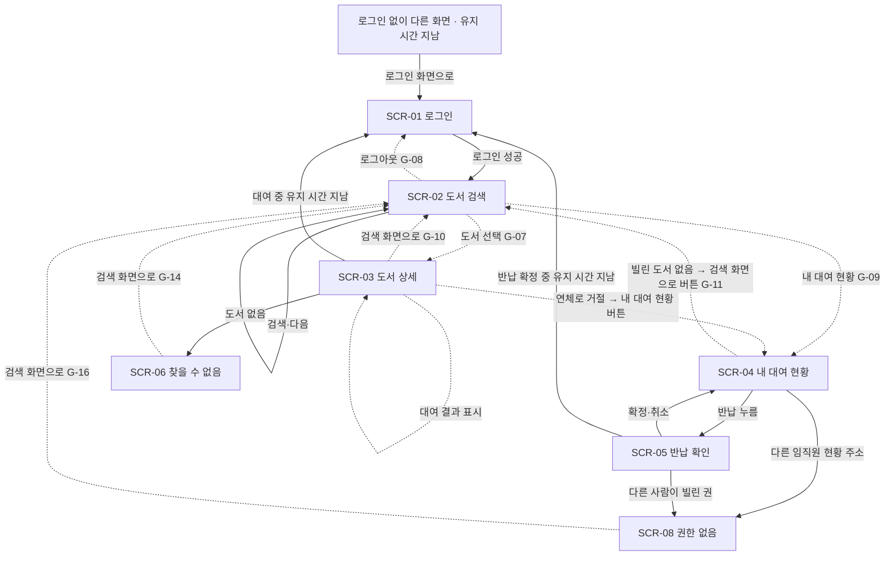

# 사내 도서 대여 서비스 화면 설계

## 1. 개요

- **모드**: 해석
- **원천**: 해석 — 시안 목록 `in/planning/m5/mockup-login.png@251c22d8aace`, `in/planning/m5/mockup-search.png@c9a286d2f29b`. 시안이 없는 화면의 근거는 `in/planning/m5/library-spec.md@7f3d2fb6fa6c §4`·`§5` 와 `plan/requirements.md`.
- **디자인 시스템**: 디자인 시스템 없음 — 레포에는 `README.md` 하나뿐이고 토큰·컴포넌트가 없다(근거: `README.md`). 그래서 모든 컴포넌트는 「새 컴포넌트」이고, 접근성은 일반 기준(글자 대비 WCAG AA, 키보드만으로 사용, 초점 표시, 색만으로 구분하지 않기)을 쓴다(A-06).
- **표기 약속**: 시안에 없던 곳은 모두 채웠다. 사람이 정한 곳은 「질문 답 반영 — G-xx·질문 id」, 승인 화면에서 AI 보완으로 정한 곳은 「AI 보완 — G-xx」로 적는다(6절 목록). G-xx 는 `ui-gaps.json` 의 빠진 항목 번호다.
- **시안이 보여 주는 것**: 로그인 시안은 상단 바(서비스 이름 「사내 도서 대여」), 제목 「로그인」, 안내 「회사 계정으로 로그인하세요」, 입력 칸 둘(「회사 계정(사번 또는 메일)」 — 예시 `user1@example.com`, 「비밀번호」 — 점 표시), 파란색 전체 폭 주 버튼 「로그인」, 그 아래 「로그인 문제는 IT 지원(내선 `<IT 지원 내선>`)에 문의하세요」 문구다. 검색 시안은 상단 바 「도서 검색」, 입력 칸 「제목 또는 저자」와 파란 「검색」 버튼, 그 아래 도서 4건(표지 자리 회색 세로 상자 · 굵은 제목 · 회색 저자 · 알약 모양 상태 뱃지 — 초록 「대여 가능 N권」, 빨강 「모두 대여 중」. 뱃지는 색과 글자 둘로 알리고 아이콘은 없다)이다.
- **시안 잘림**(AI 보완 — G-19): 두 시안 모두 오른쪽이 잘려 있다(`plan/requirements.md` 11절). **보이는 부분만 구현한다.** 오른쪽 끝의 메뉴·아이콘 등 잘린 쪽의 요소는 요구로 삼지 않는다. 로그아웃·이동 수단은 시안에 없어 상단 바에 새로 더한다(G-08·G-09).
- **상단 바**(AI 보완 — G-08·G-09): 로그인 시안은 왼쪽에 서비스 이름, 검색 시안은 화면 제목이다. 로그인 후 화면은 검색 시안대로 **왼쪽에 화면 제목**을 유지한다. 오른쪽에 「로그아웃」 버튼을 두고, 두 이동 링크 「도서 검색」·「내 대여 현황」(현재 화면 표시)은 제목 줄 아래 한 줄에 둔다(360px 폭에서 제목·로그아웃과 한 줄에 다 들어가지 않는다 — A-01). 상세는 SCR-02 컴포넌트 매핑.
- **쉬운 말 요약**: 임직원은 로그인 화면(SCR-01)에서 들어와 도서 검색(SCR-02)에서 도서를 찾고, 도서 상세(SCR-03)에서 대여 가능 권수를 보고 바로 빌린다. 빌린 도서와 반납 예정일은 내 대여 현황(SCR-04)에서 보고, 반납은 확인 대화상자(SCR-05)를 거쳐 한다. 시안이 있는 화면은 로그인과 도서 검색뿐이라 나머지 화면과 시안에 없던 상태는 AI 보완과 질문 답으로 채웠다. 서버 오류·연결 끊김은 전체 화면을 두지 않고 각 영역 안에서만 알린다(질문 S2-Q1 답).
- **화면이 없는 기능**: 아래 표. F-11~F-13 은 2차라 이 문서의 범위 밖이다(`plan/requirements.md#F-11`).

| 기능·스토리 | 화면 | 비고 |
|---|---|---|
| F-01 | SCR-01 | 로그인. 로그아웃 버튼은 상단 바(G-08) |
| F-02 | SCR-01 | 인증 실패·무응답 안내 |
| F-03 | 화면 없음 — 저장 제약(이름·부서·회사 메일만 보관, 비밀번호·사번 비보관)이라 사용자가 보는 화면이 없다 | `plan/requirements.md#F-03` |
| F-04 | SCR-02 | |
| F-05 | SCR-02 | 도서 상세에서는 권별 상태(F-06) |
| F-06 | SCR-03 | |
| F-07 | SCR-03 | 대여 결과 표시(US-08)도 SCR-03 안 |
| F-08 | SCR-04 | |
| F-09 | SCR-04, SCR-03 | 연체 안내는 SCR-04, 대여 거절 안내는 SCR-03 |
| F-10 | SCR-04, SCR-05 | |
| F-14 | 화면 없음 — 대여·반납 기록 보관(5년)은 서비스 내부 동작이다 | `plan/requirements.md#F-14` |
| F-11~F-13 | 2차 — 범위 밖 | |
| US-03 | 화면 없음 — 삭제된 번호(NFR-03·NFR-04 로 내림) | `plan/requirements.md#US-03` |
| US-12~US-14 | 2차 — 범위 밖 | `plan/requirements.md#4.2 2차` |

US-01·02 는 SCR-01, US-04·05 는 SCR-02, US-06~08 은 SCR-03, US-09·10 은 SCR-04, US-11 은 SCR-04·SCR-05 에 이어진다(2절 관련 요구).

## 2. 화면 목록

| 화면 ID | 이름 | 목적(한 문장) | 관련 요구 | 참조 |
|---|---|---|---|---|
| SCR-01 | 로그인 | 임직원이 회사 계정과 비밀번호로 로그인한다 | F-01, F-02, US-01, US-02 | `in/planning/m5/mockup-login.png@251c22d8aace` |
| SCR-02 | 도서 검색 | 제목·저자로 도서를 찾고 대여 가능 여부를 한눈에 본다 | F-04, F-05, US-04, US-05 | `in/planning/m5/mockup-search.png@c9a286d2f29b` |
| SCR-03 | 도서 상세 | 도서 정보와 권별 상태를 보고 대여하며 대여 결과를 확인한다 | F-06, F-07, US-06, US-07, US-08 | `in/planning/m5/library-spec.md@7f3d2fb6fa6c §4 3` (시안 없음) |
| SCR-04 | 내 대여 현황 | 내가 빌린 도서·반납 예정일·연체 여부를 보고 반납을 시작한다 | F-08, F-09, F-10, US-09, US-10, US-11 | `in/planning/m5/library-spec.md@7f3d2fb6fa6c §4 5` (시안 없음) |
| SCR-05 | 반납 확인(대화상자) | 반납을 확정하거나 취소한다 | F-10, US-11 | `in/planning/m5/library-spec.md@7f3d2fb6fa6c §5` (시안 없음) |
| SCR-06 | 찾을 수 없음(404) | 없는 도서·잘못된 주소를 알리고 돌아갈 길을 준다 | US-06 | `plan/requirements.md#US-06` |
| SCR-08 | 권한 없음(403) | 「접근할 수 없습니다」를 알린다 | US-09, US-11 | `plan/requirements.md#US-09` |

SCR-07·SCR-09 는 결번이다(질문 S2-Q1 — 서버 오류·연결 끊김 전체 화면을 두지 않기로 정함, 결정 로그 seq 10). 이 번호는 다시 쓰지 않는다.

## 3. 내비게이션 흐름

이어지는 순서는 요구사항이 정한 것이다. 실선은 요구가 정한 이동이고, 점선은 이동 자체는 요구에 있으나 버튼·링크가 시안에 없어 이 문서가 더한(AI 보완) 이동이다. 서버 오류·연결 끊김은 이동하지 않고 실패한 영역 안에서 안내한다(질문 S2-Q1).

- **US-01 로그인** — SCR-01 →(회사 계정·비밀번호 입력, 「로그인」 성공) SCR-02. 실패·무응답이면 SCR-01 에 머무른다. 로그인하지 않은 채 다른 화면 주소로 들어오면 SCR-01 로 간다. 로그인 유지 시간(8시간)이 지난 뒤 대여·반납을 누르면 그 처리는 하지 않고 SCR-01 로 보내며, 다시 로그인한 뒤 직접 다시 누른다. 로그아웃하면 SCR-01 로 가며 그 버튼은 상단 바 오른쪽이다(AI 보완 — G-08). 만료로 이동했을 때의 안내는 SCR-01 위쪽 안내(AI 보완 — G-18). 근거: `plan/requirements.md#US-01`
- **US-04 도서 검색** — SCR-02 에서 「검색」(빈 검색어는 전체 도서) → 같은 화면의 목록이 바뀐다. 20건을 넘으면 목록 아래 「다음」으로 다음 쪽(AI 보완 — G-06). 근거: `plan/requirements.md#US-04`
- **US-06 도서 상세** — SCR-02 →(도서 줄 전체를 눌러 이동 — AI 보완 G-07) SCR-03. 도서가 없거나 주소가 잘못되면 「도서를 찾을 수 없습니다」와 검색 화면으로 돌아가는 버튼(SCR-06 → SCR-02). 불러오지 못하면 「도서 정보를 불러오지 못했습니다」와 「다시 불러오기」·「도서 검색으로 돌아가기」 버튼. 근거: `plan/requirements.md#US-06`
- **US-07·US-08 대여와 결과** — SCR-03 에서 「대여」 → 같은 화면의 「대여」 버튼 위 안내 블록에 도서 제목과 반납 예정일 표시(AI 보완 — G-20). 연체 중이면 거절 안내와 SCR-04 로 가는 버튼. 마지막 권을 다른 사람이 먼저 빌렸으면 거절 안내(도서 상세나 검색 화면으로 돌아가 다른 도서 찾기). 별도 결과 화면은 없다. 근거: `plan/requirements.md#US-07`, `plan/requirements.md#US-08`
- **US-09·US-10 내 대여 현황** — SCR-04 로 가는 길은 상단 바 「내 대여 현황」 링크다(AI 보완 — G-09). SCR-04 에서 빌린 도서가 없으면 검색 화면으로 가는 버튼. 연체 중인 권이 있으면 위쪽에 안내 띠(AI 보완 — G-12). 다른 임직원의 현황 주소를 직접 입력하면 SCR-08. 근거: `plan/requirements.md#US-09`, `plan/requirements.md#US-10`
- **US-11 반납** — SCR-04 에서 반납할 줄의 「반납」 → SCR-05 → 확정하면 SCR-04 에서 그 줄이 사라지고 그 권은 「대여 가능」으로 돌아간다. 취소하면 아무것도 바뀌지 않고 SCR-04. 반납 처리가 실패했거나 이미 반납된 권이면 대화상자를 닫고 SCR-04 상단에 안내한다(AI 보완 — G-13). 다른 사람이 빌린 권을 처리하려 하면 SCR-08. 로그인 유지 시간이 지난 뒤 확정하면 처리하지 않고 SCR-01. 근거: `plan/requirements.md#US-11`

## 4. 화면 공통 규칙

- **되돌릴 수 없는 동작의 확인 방식**: 반납은 확인 대화상자(SCR-05)로 한 번 확인한 뒤 처리한다(A-02). 대여는 확인 단계 없이 즉시 성립한다 — 요구사항이 신청 즉시 대여로 정했다(`plan/requirements.md#US-07`).
- **오류 안내의 구분 기준**: 서버 오류·연결 끊김을 위한 **전체 화면은 두지 않는다**(질문 S2-Q1 답 — 결정 로그 seq 10 「영역 안 안내만, 전체 화면은 두지 않는다」). 영역 하나의 실패(검색 결과·도서 정보·대여 현황·대여·반납 등)는 그 영역 안 안내(요구사항 문구)로만 알린다. 서버 오류와 네트워크 실패는 사용자에게 같은 안내를 쓴다(`plan/requirements.md#US-04`·`#US-06`·`#US-09`·`#US-11`).
- **오류 안내**: 요구사항이 정한 대로 모든 오류 안내에 「무엇이 잘못됐는지」와 「다음에 할 일」을 함께 담는다(`plan/requirements.md#US-02`·`#US-04`·`#US-06`·`#US-09`·`#US-11`). 놓이는 곳은 실패한 영역 안(예: 검색은 결과 목록 자리)이며 아이콘과 글자를 한 블록으로 알리고 색만으로 구분하지 않는다(A-03). 화면마다 구체적인 모양은 해당 화면 절에 정했다.
- **권한 없음 처리**: 볼 수 없는 자원(다른 임직원의 내 대여 현황, 다른 사람이 빌린 권의 반납)은 화면 전체 안내 「접근할 수 없습니다」(SCR-08)다(`plan/requirements.md#US-09`, `plan/requirements.md#US-11`). 동작을 쓸 수 없는 경우(모든 권이 대여 중·연체 중)는 「대여」 버튼을 비활성으로 하고 사유를 함께 적는다(`plan/requirements.md#US-07`). 권한 없음 화면의 모양은 SCR-08 에 정했다(AI 보완 — G-16).
- **버튼 주/보조**: 한 면에 주(파란 바탕) 버튼은 하나이고 나머지는 보조(테두리만 있는 SCR-05 「취소」 모양)다. 자세한 지정은 화면별 절(A-16). 검색 화면으로 가는 버튼 문구는 모두 「도서 검색으로 돌아가기」다.
- **좁은 화면**: 360px 이상을 지원한다(A-01, `plan/requirements.md#NFR-02`). 그 폭에서도 가로로 밀어야 보이는 내용이 없어야 하고, 제목·저자·소개·반납 예정일 등 길이가 정해지지 않은 값은 모두 줄바꿈한다. 누르는 대상(특히 「다음」·줄마다 「반납」·새로 만드는 버튼)은 44×44px 이상으로 한다. 움직임(전환·애니메이션)은 없다 — 생기면 움직임 줄이기 설정을 따른다. 시안은 한 열 배치라 열 수가 바뀌는 곳은 없다. 시안은 오른쪽이 잘려 있어 보이는 부분만 구현한다(AI 보완 — G-19).
- **대비**: 글자 대비 4.5:1(WCAG AA)을 구현 완료 조건으로 확인할 요소는 안내·IT 지원 문구, 저자, 입력 안내 글자, 연한 초록·빨강 바탕 뱃지 글자, 새로 쓰는 색(연체 빨강·오류 안내 색)이다. 시안 색을 바꿔야 4.5:1 이 되면 그때 G- 로 올린다.
- **입력 오류 표시**: 칸이 비었거나 서버가 필드별 오류를 돌려주면 해당 입력 칸 바로 아래에 문구로 보이고 그 칸으로 초점을 옮긴다. 인증 실패·무응답은 필드 오류가 아니므로 입력 칸 아래·「로그인」 버튼 위의 안내 블록으로 초점을 옮긴다(질문 S2-Q2·S2-Q3 답 — G-01). 제출 버튼은 처리 중에만 비활성이다(A-04). 입력이 있는 화면은 SCR-01(두 칸)과 SCR-02(검색어 한 칸)뿐이다.

### 4-1. 공통 화면

레포에 화면이 없다(근거: `README.md` — 레포에 소스 없음). 새로 그린다.

| 화면 id | 화면 | 언제 보이나 | 사용자가 할 수 있는 것 | 레포에 있나(근거) |
|---|---|---|---|---|
| SCR-06 | 찾을 수 없음(404) | 도서가 없어졌거나 주소가 잘못됐을 때 — 문구 「도서를 찾을 수 없습니다」(`plan/requirements.md#US-06`) | 「도서 검색으로 돌아가기」 버튼(AI 보완 — G-14) | 없음 — `README.md` 외 파일 없음 |
| — | 서버 오류(500) | 전체 화면 없음 — 영역 안 안내(결정 S2-Q1, 결정 로그 seq 10). SCR-07 은 결번. AI 보완 — G-15: S2-Q1 답에 따라 전체 화면을 두지 않음 | 각 영역 안 안내와 그 안의 다음 행동 버튼 — SCR-02 「다시 검색」, SCR-03 「다시 불러오기」, SCR-04 「다시 불러오기」·상단 안내의 「현황 다시 불러오기」(화면별 절) | 해당 없음 |
| SCR-08 | 권한 없음(403) | 다른 임직원의 현황·다른 사람이 빌린 권의 반납 — 문구 「접근할 수 없습니다」(`plan/requirements.md#US-09`, `plan/requirements.md#US-11`) | 「도서 검색으로 돌아가기」 버튼(AI 보완 — G-16) | 없음 |
| — | 연결 끊김 | 전체 화면 없음 — 영역 안 안내(결정 S2-Q1, 결정 로그 seq 10). SCR-09 는 결번. AI 보완 — G-17: S2-Q1 답에 따라 전체 화면을 두지 않음 | 각 영역 안 안내와 그 안의 다음 행동 버튼(위 서버 오류 행과 같다. SCR-01 은 안내 블록을 보고 다시 입력) | 해당 없음 |

## 5. 화면별 설계

### SCR-01 로그인

- **목적**: 임직원이 회사 계정(사번 또는 메일)과 비밀번호로 로그인한다.
- **참조**: `in/planning/m5/mockup-login.png@251c22d8aace`
- **들어오는 길 / 나가는 길**: 처음 접속, 로그인하지 않은 채 다른 화면 주소로 들어옴, 로그인 유지 시간이 지난 뒤 대여·반납을 누름(`plan/requirements.md#US-01`) → 로그인 성공 시 SCR-02.
- **배치(위에서 아래)**: 상단 바(서비스 이름) → 되돌아왔을 때 안내 블록(G-18, 있을 때만 — 유지 시간 만료로 거절됐으면 「처리되지 않았습니다. 다시 로그인한 뒤 직접 다시 눌러 주세요」, 로그인 없이 주소로 들어왔으면 「로그인해 주세요」. 둘은 동시에 보이지 않는다) → 제목 「로그인」 → 안내 「회사 계정으로 로그인하세요」 → 회사 계정 칸 → 비밀번호 칸 → 로그인 실패 안내 블록(있을 때만, 질문 답 반영 — G-01·S2-Q2·S2-Q3) → 「로그인」 버튼 → IT 지원 문구. 로그인 화면의 상단 바에는 로그아웃·이동 링크가 없다.

#### 데이터

| 필드 | 보이기/입력 | 타입·형식 | 규칙(필수·길이·범위) | 출처(요구 id) |
|---|---|---|---|---|
| 회사 계정(사번 또는 메일) | 입력 | 글자. 시안 예시 `user1@example.com` | 필수(비면 그 칸 아래에 「회사 계정을 입력해 주세요」 문구). 길이·형식 제한은 요구에 없음 | F-01, US-01 |
| 비밀번호 | 입력 | 글자(입력값을 점으로 가림 — 시안) | 필수(비면 그 칸 아래에 「비밀번호를 입력해 주세요」 문구). 서비스는 저장하지 않는다. 인증 실패 후에는 칸을 비운다 | F-01, F-02, NFR-04 |
| IT 지원 안내 | 보이기 | 글자 — 내선 `<IT 지원 내선>` | 시안 문구 「로그인 문제는 IT 지원(내선 `<IT 지원 내선>`)에 문의하세요」 | US-01 |
| 로그인 실패 안내 | 보이기 | 글자 | 계정·비밀번호 중 어느 쪽이 틀렸는지 알리지 않는다(요구사항 A-02) | F-02, US-02 |
| 되돌아옴 안내(G-18) | 보이기 | 글자 | 제목 위 안내 블록 한 자리에 경우별로 하나만. 유지 시간 만료로 처리가 거절된 경우 「처리되지 않았습니다. 다시 로그인한 뒤 직접 다시 눌러 주세요」. 로그인 없이 주소로 들어온 경우 「로그인해 주세요」(처리 취소가 아니므로 만료 문구를 쓰지 않는다). 둘 다 알림 영역으로 읽히고 초점은 옮기지 않는다(첫 입력 칸 순서 그대로) | US-01 |

#### 상태

| 상태 | 사용자가 보는 것 | 사용자가 할 수 있는 것 | 비고 |
|---|---|---|---|
| 기본 | 시안 그대로 — 상단 바, 제목 「로그인」, 안내 문구, 입력 칸 둘, 주 버튼 「로그인」, IT 지원 문구. 로그인 없이 주소로 들어왔으면 제목 위에 안내 블록 「로그인해 주세요」가 더해진다(AI 보완 — G-18) | 두 칸을 입력하고 「로그인」을 누른다 | 「로그인해 주세요」 블록은 알림 영역이고 초점은 옮기지 않는다 |
| 빈 | 해당 없음 — 목록이 없는 입력 화면이다 | | |
| 로딩 | AI 보완 — G-02: 확인하는 동안 「로그인」 버튼 글자가 「확인 중」으로 바뀌고 같은 제출이 반복되지 않는다. 버튼은 진짜 비활성이 아니라 `aria-disabled` 로 두어 초점을 유지하고, 눌러도 제출하지 않는다. 입력 칸은 그대로 보인다 | 기다린다(눌러도 새 제출 없음) | 회사 계정 시스템 응답은 10초까지 기다린다(`plan/requirements.md#US-02`). 「확인 중」은 알림 영역으로도 읽힌다 |
| 오류 | 질문 답 반영 — G-01·S2-Q2·S2-Q3: **입력 칸 아래, 「로그인」 버튼 위**에 아이콘과 글자로 된 안내 블록. 인증 실패 — 「계정 또는 비밀번호가 맞지 않습니다. 다시 입력해 주세요. 계속되면 IT 지원(내선 `<IT 지원 내선>`)에 문의하세요」. 무응답(10초) — 「회사 계정 확인을 하지 못했습니다. 다시 시도해 주세요. 계속되면 IT 지원(내선 `<IT 지원 내선>`)에 문의하세요」. 빈 칸은 안내 블록이 아니라 해당 칸 아래 문구(데이터 절) | 입력은 그대로 두고 비밀번호만 비운 채 다시 입력한다 | 인증 실패·무응답 때 초점은 안내 블록으로 옮긴다. 칸이 비었을 때는 로그인을 진행하지 않고 그 칸으로 초점을 옮긴다(`plan/requirements.md#US-01`, 표시는 A-04) |
| 권한 없음 | 해당 없음 — 로그인 전 화면이라 권한 개념이 없다 | | 되돌아왔을 때 안내는 배치·데이터·기본 상태에 정했다(G-18) |

#### 상호작용

| 동작 | 결과 | 되돌릴 수 있나 | 확인 단계 |
|---|---|---|---|
| 「로그인」 누름(두 칸 입력) | 회사 계정 시스템으로 확인해 성공이면 SCR-02 로 간다 | 해당 없음(로그아웃은 상단 바 — G-08) | 없음 |
| 「로그인」 누름(빈 칸 있음) | 로그인을 진행하지 않고 빈 칸 아래에 문구, 첫 빈 칸으로 초점 | 해당 없음 | 없음 |
| 「로그인」 누름(인증 실패·무응답) | 안내 블록, 비밀번호 칸 비움, 초점은 안내 블록 | 해당 없음 | 없음 |

#### 기존 컴포넌트 매핑

| 화면 요소 | 컴포넌트 | 비고 |
|---|---|---|
| 상단 바 | 새 컴포넌트 — 레포에 컴포넌트 없음(시안 모양: 흰 바, 왼쪽에 굵은 서비스 이름) | |
| 입력 칸 둘 | 새 컴포넌트 — 레포에 컴포넌트 없음(시안 모양: 위에 라벨, 둥근 테두리, 안내 예시 글자) | 비밀번호 칸은 입력값을 점으로 가림. 칸 아래 오류 문구 자리 포함 |
| 주 버튼 「로그인」 | 새 컴포넌트 — 레포에 컴포넌트 없음(시안 모양: 파란 바탕·흰 글씨·전체 폭·둥근 모서리) | 「확인 중」 모양 포함(G-02) |
| IT 지원 안내 | 새 컴포넌트 — 레포에 컴포넌트 없음(시안 모양: 작은 회색 글씨) | |
| 안내 블록(실패·되돌아옴·로그인 요청) | 새 컴포넌트 — 레포에 컴포넌트 없음(아이콘+글자, 전체 폭, 둥근 모서리, 오류 색 테두리) | 실패 안내는 입력 칸 아래·버튼 위(G-01), 되돌아옴 안내는 제목 위(G-18). 오류 안내 블록은 SCR-02·03·04 도 같은 모양을 쓴다 |

#### 접근성 메모

- 초점 순서는 회사 계정 → 비밀번호 → 「로그인」이고, 엔터로 제출할 수 있다.
- 입력 칸 라벨은 시안처럼 글자로 항상 보이게 두고(안내 예시 글자만으로 라벨을 대신하지 않는다), 오류는 아이콘·글자로 알리고 색만으로 구분하지 않는다.
- 안내 글자(작은 회색, IT 지원 문구)와 입력 칸 안내 예시 글자, 파란 버튼 글씨의 대비는 시안에서 측정하지 않았다. 4.5:1(WCAG AA)을 구현 완료 조건으로 확인한다(4절 대비).
- 오류 문구가 나타나면 스크린리더가 읽을 수 있게 알림 영역으로 둔다. 인증 실패·무응답 때 초점은 안내 블록으로 옮긴다(G-01·S2-Q2·S2-Q3). 빈 칸 오류는 그 칸으로 초점을 옮기고 칸과 문구를 연결한다.
- 「확인 중」 동안 버튼은 `aria-disabled` 라 초점을 잃지 않고, 누르는 대상은 44×44px 이상이다.

### SCR-02 도서 검색

- **목적**: 제목·저자로 도서를 찾고 결과에서 대여 가능 여부를 본다.
- **참조**: `in/planning/m5/mockup-search.png@c9a286d2f29b`
- **들어오는 길 / 나가는 길**: 로그인 성공(SCR-01) → 여기. 도서 줄 전체를 누르면 SCR-03(AI 보완 — G-07). 상단 바 「내 대여 현황」 링크로 SCR-04(G-09), 「로그아웃」으로 SCR-01(G-08).

#### 데이터

| 필드 | 보이기/입력 | 타입·형식 | 규칙(필수·길이·범위) | 출처(요구 id) |
|---|---|---|---|---|
| 검색어(「제목 또는 저자」) | 입력 | 글자 | 선택. 앞뒤 공백 무시, 대소문자 구분 없음, 공백만이면 빈 검색어(전체 도서), 100자를 넘으면 100자에서 잘라 검색 | F-04, US-04 |
| 표지 | 보이기 | 이미지 | 없는 도서는 시안의 회색 자리 상자(요구사항 A-14) | US-04 |
| 제목 | 보이기 | 글자 | 굵게(시안) | F-04 |
| 저자 | 보이기 | 글자 | 회색 작은 글씨(시안) | F-04 |
| 대여 가능 권수 / 모두 대여 중 | 보이기 | 수 → 「대여 가능 N권」, 0이면 「모두 대여 중」 | 초록·빨강 알약 뱃지(시안 — 색과 글자 둘, **아이콘 없이 간다**: AI 보완 — G-21). 갱신은 화면을 열 때·새로고침·검색을 실행할 때 | F-05, US-05 |
| 「다음」 | 입력(동작) | 버튼 하나 | 목록 아래, 다음 쪽이 있을 때만 보인다(AI 보완 — G-06). 한 쪽 20건 | F-04, US-04 |

#### 상태

| 상태 | 사용자가 보는 것 | 사용자가 할 수 있는 것 | 비고 |
|---|---|---|---|
| 기본 | 시안 그대로 — 상단 바 「도서 검색」(오른쪽 「로그아웃」, 아래 이동 링크: G-08·G-09), 검색 칸과 「검색」 버튼, 도서 줄(표지 자리·제목·저자·상태 뱃지) 목록, 20건을 넘으면 목록 아래 「다음」 | 검색어를 넣고 「검색」을 누른다. 도서 줄을 눌러 상세로 간다 | 시안 예시 4건: 클린 코드(대여 가능 1권), 도메인 주도 설계(모두 대여 중), 리팩터링 2판(대여 가능 2권), 객체지향의 사실과 오해(대여 가능 1권) |
| 빈 | AI 보완 — G-03: 목록 자리에 「검색 결과가 없습니다」 문구, 「다른 검색어로 다시 검색하거나 검색어를 비워 전체 도서를 볼 수 있습니다」 설명, 「전체 도서 보기」 버튼 | 다시 검색한다. 「전체 도서 보기」는 검색어를 비우고 검색을 실행한다 | `plan/requirements.md#US-04` |
| 로딩 | AI 보완 — G-04: 목록 자리에 「불러오는 중」 글자를 보이고 이전 결과는 숨긴다 | 기다린다 | 알림 영역으로 읽힌다 |
| 오류 | AI 보완 — G-05: 결과 목록 자리에 아이콘과 글자로 「검색하지 못했습니다. 다시 검색해 주세요. 계속되면 IT 지원(내선 `<IT 지원 내선>`)에 문의하세요」와 보조 버튼 「다시 검색」을 안내 블록 안에 둔다. 이전 결과를 남겨 두지 않는다. 서버 오류·연결 끊김 모두 이 영역 안 안내만 쓴다(S2-Q1) | 「다시 검색」을 누르거나 검색어를 고쳐 다시 검색한다 | `plan/requirements.md#US-04` |
| 권한 없음 | 해당 없음 — 로그인한 임직원 모두 같은 화면을 쓴다(로그인하지 않은 접근은 SCR-01 로 보낸다) | | |

#### 상호작용

| 동작 | 결과 | 되돌릴 수 있나 | 확인 단계 |
|---|---|---|---|
| 「검색」 누름 | 제목이나 저자에 검색어가 들어간 도서 목록으로 바뀐다(빈 검색어는 전체 도서) | 예 | 없음 |
| 「다음」 누름 | 다음 20건을 본다(마지막 쪽은 남은 건수). 마지막 쪽에서는 「다음」을 숨긴다. 「이전」은 두지 않는다(앞 쪽으로 돌아가려면 다시 검색 — AI 보완 G-06, A-10) | 예(다시 검색) | 없음 |
| 「다시 검색」 누름(오류 안내 안) | 직전에 실행하려던 검색어로 검색을 다시 실행한다. 로딩 상태로 바뀌고 성공하면 결과, 또 실패하면 같은 안내 | 예 | 없음 |
| 도서 줄 선택 | 줄 전체(표지·제목·저자·뱃지 어디든)가 눌림 대상이고 SCR-03 이 열린다(`plan/requirements.md#US-06`). 눌림 표시와 키보드 초점 표시를 둔다(AI 보완 — G-07) | 예 | 없음 |

#### 기존 컴포넌트 매핑

| 화면 요소 | 컴포넌트 | 비고 |
|---|---|---|
| 상단 바 | 새 컴포넌트 — 레포에 컴포넌트 없음(시안 모양: 흰 바, 굵은 화면 제목). 로그인 이후 모든 화면 공통이며 여기서 대표로 적는다. 왼쪽 화면 제목, 오른쪽 「로그아웃」 버튼(G-08), 제목 줄 아래 이동 링크 「도서 검색」·「내 대여 현황」과 현재 화면 표시(G-09). 잘린 오른쪽은 요구로 삼지 않는다(G-19). 왼쪽 제목은 화면마다 아래 표대로다(G-09) | 이동 링크 「도서 검색」·「내 대여 현황」은 로그인 이후 모든 화면의 제목 줄 아래에 둔다 |
| 검색 입력 칸 | 새 컴포넌트 — 레포에 컴포넌트 없음(시안 모양: 둥근 테두리, 안내 글자 「제목 또는 저자」) | |
| 「검색」 버튼 | 새 컴포넌트 — 레포에 컴포넌트 없음(시안 모양: 파란 바탕·흰 글씨, 검색 칸 오른쪽) | |
| 도서 줄 | 새 컴포넌트 — 레포에 컴포넌트 없음(시안 모양: 왼쪽 표지 자리, 오른쪽에 제목·저자·뱃지, 줄 사이 가는 구분선). 줄 전체가 누르는 대상(G-07) | |
| 표지 자리 | 새 컴포넌트 — 레포에 컴포넌트 없음(시안 모양: 청회색 세로 상자) | 표지 없는 도서에 사용(요구사항 A-14) |
| 상태 뱃지 | 새 컴포넌트 — 레포에 컴포넌트 없음(시안 모양: 알약, 초록 바탕 「대여 가능 N권」 / 빨강 바탕 「모두 대여 중」, 아이콘 없음 — G-21) | |
| 「다음」·「전체 도서 보기」 버튼 | 새 컴포넌트 — 레포에 컴포넌트 없음(보조 버튼 모양 — SCR-05 「취소」와 같은 테두리만 있는 모양, 목록 폭. 이 면의 주 버튼은 「검색」 하나다) | G-06·G-03 |
| 목록 자리 안내 블록 | 새 컴포넌트 — 레포에 컴포넌트 없음(SCR-01 안내 블록과 같은 모양) | 빈·로딩·오류 |
| 보조 버튼(「전체 도서 보기」·「다시 검색」 등) | 새 컴포넌트 — 레포에 컴포넌트 없음. SCR-05 「취소」와 같은 테두리만 있는 모양 | 면마다 주 버튼은 하나(4절) |

로그인 이후 화면의 상단 바 왼쪽 제목(G-09, 용어집 정식 용어):

| 화면 | 왼쪽 제목 |
|---|---|
| SCR-02 | 도서 검색 |
| SCR-03 | 도서 상세 |
| SCR-04 | 내 대여 현황 |
| SCR-06 | 찾을 수 없음 |
| SCR-08 | 접근할 수 없음 |

SCR-05 는 대화상자라 상단 바를 바꾸지 않는다(뒤 화면 SCR-04 의 상단 바 그대로). SCR-01 은 로그인 전이라 서비스 이름 「사내 도서 대여」다.

#### 접근성 메모

- 초점 순서는 검색 칸 → 「검색」 → 결과 줄 → 「다음」 순이고, 엔터로 검색한다. 「다음」을 누르면 초점을 새 목록의 첫 줄로 옮긴다.
- 시안의 상태 뱃지는 색과 글자(「대여 가능 N권」·「모두 대여 중」) 둘이고 아이콘은 없다. 글자가 이미 있어 색만으로 구분하지는 않으므로 아이콘 없이 간다(G-21). 뱃지 글자 대비는 4.5:1 을 구현 완료 조건으로 확인한다(4절).
- 검색 입력 칸의 접근 가능한 이름은 「제목 또는 저자」다(보이지 않는 라벨이라도 보조기기가 읽는 이름을 둔다). 시안은 칸 안 안내 글자만 있고 보이는 라벨이 없어 SCR-01(항상 보이는 글자 라벨)과 규칙이 다르다.
- 표지 자리는 장식이라 보조기기에서는 읽지 않게 하고, 줄의 이름은 제목이다.
- 키보드만으로 결과 줄을 선택해 이동할 수 있다(줄 전체가 하나의 링크, 엔터로 열림 — G-07). 「로그아웃」·이동 링크도 키보드로 누를 수 있다.
- 「불러오는 중」·빈 결과·오류 안내는 알림 영역으로 읽힌다. 오류 안내 안의 「다시 검색」은 키보드로 누를 수 있고 44×44px 이상이며, 누르면 초점은 로딩 뒤 새 목록(또는 안내)의 첫 줄로 옮긴다.

### SCR-03 도서 상세

- **목적**: 도서 정보와 권별 상태를 보고 대여하고, 대여 결과(도서 제목·반납 예정일)를 같은 화면에서 확인한다. 별도 결과 화면은 두지 않는다(A-07).
- **참조**: `in/planning/m5/library-spec.md@7f3d2fb6fa6c §4 3` (시안 없음 — 레이아웃은 AI 보완 G-10)
- **들어오는 길 / 나가는 길**: SCR-02 에서 도서 줄 선택 → 여기. 상단 바 링크로 검색 화면·내 대여 현황으로, 연체로 거절되면 SCR-04 로 가는 버튼(`plan/requirements.md#US-07`).
- **배치(AI 보완 — G-10)**: 한 열로 위에서부터 상단 바 → 표지 → 제목 → 저자 → 출판사 → 소개 → 권별 상태 목록 → 안내 블록(G-20, 있을 때만) → 주 버튼 「대여」. 표지 자리는 SCR-02 시안 모양을 쓴다.

#### 데이터

| 필드 | 보이기/입력 | 타입·형식 | 규칙(필수·길이·범위) | 출처(요구 id) |
|---|---|---|---|---|
| 표지 | 보이기 | 이미지 | 없으면 회색 자리 상자(요구사항 A-14) | F-06 |
| 제목·저자·출판사·소개 | 보이기 | 글자 | 길이 제한은 요구에 없음. 모두 줄바꿈 | F-06, US-06 |
| 권별 상태 | 보이기 | 권마다 한 줄 — 「권 1 — 대여 가능」 / 「권 2 — 대여 중」 처럼 순번과 상태 | 권 상태는 두 가지뿐. 색과 글자 둘로 알리고 아이콘은 없다(G-21) | F-06 |
| 대여 가능 권수 | 보이기 | 수 | 0이면 「대여」 비활성 + 모든 권이 대여 중이라는 이유 | F-07 |
| 요청 식별자 | 숨김(전송) | 화면이 「대여」 제출마다 발급 | 같은 값의 제출은 한 번만 처리. 새로 연 화면에서는 새 값 | F-07, US-07 |
| 대여 결과: 도서 제목, 반납 예정일 | 보이기 | 글자, 날짜(한국 표준시 날짜 기준, 표기는 A-08) | 반납 예정일 = 대여일 + 14일 | F-07, US-08 |

#### 상태

| 상태 | 사용자가 보는 것 | 사용자가 할 수 있는 것 | 비고 |
|---|---|---|---|
| 기본 | AI 보완 — G-10: 위 배치 그대로(내용은 데이터 절). 상단 바는 SCR-02 와 같다(G-08·G-09) | 「대여」 | |
| 기본 — 「대여」 비활성(화면을 연 시점부터) | 「대여」 버튼은 비활성이고 사유를 글자로 곁들인다. 모든 권이 대여 중이면 「모든 권이 대여 중입니다」 취지(예약은 없다), 연체 중이면 연체 중인 도서가 있어 새로 빌릴 수 없다는 안내와 보조(테두리) 버튼 「내 대여 현황으로」(이 면의 주 버튼은 비활성 「대여」 하나). 두 사유가 겹치면 연체 중 사유를 우선 보인다(A-09). 사유는 「대여」 버튼 위 안내 블록에 놓인다(AI 보완 — G-20) | 연체 중이면 내 대여 현황으로 | 문구 내용은 `plan/requirements.md#US-07` |
| 빈 | 해당 없음 — 도서가 있어야 열리는 화면이다. 도서가 없으면 SCR-06 | | |
| 로딩 | AI 보완 — G-10: 도서 정보 자리에 「불러오는 중」 글자. 이 동안 「대여」는 보이지 않는다 | 기다린다 | 알림 영역으로 읽힌다 |
| 오류 | 요구가 정한 문구: 「도서 정보를 불러오지 못했습니다」, 주 버튼 「다시 불러오기」, 보조(테두리) 버튼 「도서 검색으로 돌아가기」를 아이콘+글자 안내 블록(G-10)에 둔다. 불러오지 못한 화면에서는 「대여」를 할 수 없다(버튼을 보이지 않는다). 서버 오류·연결 끊김 모두 이 영역 안 안내만 쓴다(S2-Q1) | 「다시 불러오기」, 「도서 검색으로 돌아가기」 | `plan/requirements.md#US-06`. 대여 처리 중 실패는 「대여」 버튼 위 안내 블록(G-20)에 대여가 되지 않았거나 결과를 확인하지 못함 + 내 대여 현황에서 확인한 뒤 필요하면 다시 대여하라는 안내(US-08) |
| 권한 없음 | 해당 없음 — 모든 임직원이 같은 정보를 본다. 「대여」를 쓸 수 없는 경우는 위 「기본 — 「대여」 비활성」 행(화면을 연 시점부터)과 아래 상호작용(누른 시점의 거절) | | |

#### 상호작용

| 동작 | 결과 | 되돌릴 수 있나 | 확인 단계 |
|---|---|---|---|
| 「대여」 누름(대여 가능 권 있음, 연체 중 아님) | 대여 가능 권 하나가 즉시 내게 대여되고 그 권은 「대여 중」이 되며, 「대여」 버튼 위 안내 블록에 도서 제목과 반납 예정일을 보인다(US-07·US-08, G-20) | 대여를 취소하는 동작은 없다 — 반납으로 끝낸다 | 없음(즉시 대여) |
| 「대여」 누름(화면을 연 뒤 연체가 발생해 처리 때 확인됨) | 거절한다. 안내 블록: 연체 중인 도서가 있어 새로 빌릴 수 없음 + 내 대여 현황에서 연체 도서를 반납한 뒤 다시 빌리기. 보조(테두리) 버튼 「내 대여 현황으로」를 함께 보인다 | 해당 없음 | 없음 |
| 「대여」 누름(그 사이 마지막 권을 다른 사람이 빌림) | 거절하고 안내 블록: 방금 모든 권이 대여 중이 됨 + 보조(테두리) 버튼 「도서 검색으로 돌아가기」로 다른 도서 찾기 | 해당 없음 | 없음 |
| 같은 제출을 연달아 두 번 | 대여는 1건만 생기고 두 번째 응답은 첫 번째 결과를 그대로 보여 준다 | 해당 없음 | 없음 |
| 로그인 유지 시간이 지난 뒤 「대여」 | 그 처리는 하지 않고 SCR-01 로 보낸다. 다시 로그인한 뒤 직접 다시 누른다 | 해당 없음 | 없음 |

도서 정보 배치·버튼 모양은 위 배치(AI 보완 — G-10), 대여 결과와 거절·비활성 사유 문구는 「대여」 버튼 위 안내 블록 하나에 보이고 스크린리더가 읽는 알림 영역이다(AI 보완 — G-20).

#### 기존 컴포넌트 매핑

| 화면 요소 | 컴포넌트 | 비고 |
|---|---|---|
| 상단 바 | 새 컴포넌트 — 레포에 컴포넌트 없음. SCR-02 의 상단 바와 같다(G-08·G-09) | |
| 도서 정보 영역·권별 상태 목록·「대여」 버튼·안내 블록 | 새 컴포넌트 — 레포에 컴포넌트 없음. 시안 없음이라 배치는 G-10·G-20 으로 정했다. 표지 자리·상태 표시는 SCR-02 시안 모양(회색 상자, 색과 글자 둘인 초록·빨강 알약, 아이콘 없음 — G-21)을 따르고, 안내 블록·주 버튼은 SCR-01 모양을 따른다. 안내 블록 안 버튼 둘이 나란할 때는 주(파란 바탕)/보조(SCR-05 「취소」와 같은 테두리만 있는 모양)를 위 표대로 지정한다 | 오류 안내 블록은 「다시 불러오기」가 주, 「도서 검색으로 돌아가기」가 보조 |

#### 접근성 메모

- 주 행동은 「대여」 하나이고 비활성일 때는 이유를 글자로 곁들이며 색만으로 알리지 않는다.
- 대여 결과·거절 안내는 스크린리더가 읽을 수 있게 알림 영역으로 둔다(G-20). 대여 결과가 나오면 초점을 안내 블록으로 옮긴다.
- 권별 상태는 색과 글자(「대여 가능」·「대여 중」) 둘로 알리고 아이콘은 없다(시안 SCR-02 뱃지와 같은 방식, G-21). 글자가 있어 색만으로 구분하지 않는다.
- 사용할 수 없는 「대여」 버튼도 사유를 글자로 읽을 수 있어야 하므로 `aria-disabled` 로 초점을 받게 하고 사유 글과 연결한다.
- 누르는 대상은 44×44px 이상, 저자·소개 등 긴 글은 줄바꿈한다(4절).
- 키보드만으로 대여할 수 있어야 한다. 이미지·아이콘만 있는 버튼은 만들지 않는다.

### SCR-04 내 대여 현황

- **목적**: 내가 빌려 아직 반납하지 않은 권의 도서 제목·반납 예정일·연체 여부를 보고 반납을 시작한다.
- **참조**: `in/planning/m5/library-spec.md@7f3d2fb6fa6c §4 5`·`§4 6` (시안 없음 — 레이아웃은 AI 보완 G-11)
- **들어오는 길 / 나가는 길**: 상단 바 「내 대여 현황」 링크(G-09), SCR-03 의 연체 거절 안내 버튼. 나가는 길: 「반납」 → SCR-05, 빌린 도서가 없으면 검색 화면으로 가는 버튼, 다른 임직원의 현황 주소 → SCR-08.
- **배치(AI 보완 — G-11·G-12)**: 상단 바 → 반납 실패·이미 반납됨 안내 블록(있을 때만, G-13 — 안내 글 아래에 보조 버튼 「현황 다시 불러오기」) → 연체 안내 띠(연체 중인 권이 있을 때만, G-12) → 대여 한 건 줄 목록. 한 줄에는 제목(굵게), 「반납 예정일 YYYY-MM-DD」, 연체이면 빨간 알약 뱃지 「연체」, 줄 아래쪽에 보조(테두리) 버튼 「반납」 — 줄이 여럿이라 파란 주 버튼이 반복되지 않게 한다. 정렬은 반납 예정일이 빠른 순(같은 날이면 먼저 빌린 순 — A-12).

#### 데이터

| 필드 | 보이기/입력 | 타입·형식 | 규칙(필수·길이·범위) | 출처(요구 id) |
|---|---|---|---|---|
| 도서 제목 | 보이기 | 글자 | 줄 하나 = 대여 한 건. 같은 도서의 두 권을 빌렸으면 두 줄 | F-08, US-09 |
| 반납 예정일 | 보이기 | 날짜(표기는 A-08) | 대여일 + 14일, 한국 표준시 날짜 기준. 이른 날짜가 위 | F-08 |
| 연체 여부 | 보이기 | 연체 / 아님 | 반납 예정일이 지났는데 반납하지 않았으면 연체(빨간 알약 뱃지 「연체」). 예정일 당일은 연체 아님 | F-09, US-10 |
| 연체 안내 | 보이기 | 글자 | 연체 중인 권이 하나라도 있으면 목록 위쪽 안내 띠에: 연체 중이라 새로 빌릴 수 없고 연체 도서를 반납하면 다시 빌릴 수 있음 | F-09, US-10 |
| 「반납」 | 입력(동작) | 줄마다 하나, 보조(테두리) 버튼 | 눌린 그 한 건만 처리. 연체 중이어도 가능 | F-10, US-11 |
| 반납 실패·이미 반납됨 안내(G-13) | 보이기 | 글자 + 보조 버튼 「현황 다시 불러오기」 | 화면 상단 안내 블록(알림 영역). 반납이 되지 않았거나 결과를 확인하지 못함 + 현황을 다시 불러와 확인한 뒤 필요하면 다시 반납, 또는 이미 반납되었음. 버튼을 누르면 목록을 다시 불러온다 | F-10, US-11 |

#### 상태

| 상태 | 사용자가 보는 것 | 사용자가 할 수 있는 것 | 비고 |
|---|---|---|---|
| 기본 | AI 보완 — G-11·G-12: 위 배치 그대로(내용은 데이터 절). 상단 바는 SCR-02 와 같다(G-08·G-09). 연체 줄에는 「연체」 뱃지, 목록 위에 안내 띠 | 「반납」 | 정렬은 반납 예정일이 빠른 순(G-11). 반납 실패·이미 반납됨 안내는 이 화면 상단에 보인다(AI 보완 — G-13) |
| 빈 | 요구가 정한 문구 「빌린 도서가 없습니다」와 주 버튼 「도서 검색으로 돌아가기」를 안내 블록에 둔다(AI 보완 — G-11) | 검색 화면으로 | `plan/requirements.md#US-09` |
| 로딩 | AI 보완 — G-11: 목록 자리에 「불러오는 중」 글자 | 기다린다 | 알림 영역으로 읽힌다 |
| 오류 | 요구가 정한 문구 「대여 현황을 불러오지 못했습니다」와 주 버튼 「다시 불러오기」를 아이콘+글자 안내 블록에 둔다(AI 보완 — G-11). 이때 빈 목록 문구(「빌린 도서가 없습니다」)를 대신 보이지 않는다. 서버 오류·연결 끊김 모두 이 영역 안 안내만 쓴다(S2-Q1) | 다시 불러오기 | `plan/requirements.md#US-09` |
| 권한 없음 | 다른 임직원의 현황 주소를 직접 입력하면 「접근할 수 없습니다」(SCR-08). 주소로 들어갔을 때와 화면으로 들어갔을 때 결과가 같다 | | `plan/requirements.md#US-09` |

#### 상호작용

| 동작 | 결과 | 되돌릴 수 있나 | 확인 단계 |
|---|---|---|---|
| 줄의 「반납」 누름 | SCR-05 가 열린다 | 예(확정 전) | SCR-05 |
| 「현황 다시 불러오기」 누름(상단 안내 안) | 목록을 다시 불러온다(목록 자리 로딩 → 결과). 성공하면 상단 안내를 닫고 최신 목록을 보인다. 다시 불러오기에 실패하면 이 화면의 오류 상태(「대여 현황을 불러오지 못했습니다」)로 바뀐다 | 예 | 없음 |
| 연체 안내 | 보기만 한다(연체 중이어도 반납은 막지 않는다) | 해당 없음 | 없음 |

#### 기존 컴포넌트 매핑

| 화면 요소 | 컴포넌트 | 비고 |
|---|---|---|
| 상단 바 | 새 컴포넌트 — 레포에 컴포넌트 없음. SCR-02 의 상단 바와 같다(G-08·G-09) | |
| 대여 한 건 줄·「반납」 버튼·연체 안내 띠 | 새 컴포넌트 — 레포에 컴포넌트 없음. 시안 없음이라 G-11·G-12 로 정했다. 알약 뱃지는 SCR-01·SCR-02 시안 모양을 따르고, 안내 띠·안내 블록은 SCR-01 안내 블록 모양을 따른다. 줄마다 「반납」과 상단 안내의 「현황 다시 불러오기」는 보조(SCR-05 「취소」와 같은 테두리만 있는 모양), 빈·오류 상태의 단독 버튼은 주(파란 바탕) 모양이다 | |

#### 접근성 메모

- 줄마다 「반납」 버튼의 이름에 도서 제목을 포함해 어느 줄의 버튼인지 구별되게 한다.
- 연체는 색과 「연체」 글자 둘로 알린다(SCR-02 뱃지와 같은 방식이라 아이콘은 없다 — G-21). 글자가 있어 색만으로 구분하지 않는다. 새로 쓰는 연체 빨강은 글자 대비 4.5:1 을 확인한다(4절).
- 연체 안내 띠는 글자로 알리고 알림 영역으로 읽힌다.
- 상단 안내 블록의 「현황 다시 불러오기」는 키보드로 누를 수 있고 44×44px 이상이다. 안내로 초점이 옮겨진 뒤 탭 한 번에 이 버튼에 닿는다. 누르면 다시 불러온 목록 맨 위(또는 오류 안내)로 초점을 옮긴다.
- 줄마다 「반납」 버튼은 44×44px 이상이고 제목·반납 예정일 등 긴 값은 줄바꿈한다(4절).
- 반납 확정·취소 뒤 초점은 그 줄(사라졌으면 목록 맨 위)로 돌아간다.

### SCR-05 반납 확인(대화상자)

- **목적**: 반납할 대여 한 건을 확인한 뒤 확정하거나 취소한다.
- **참조**: `in/planning/m5/library-spec.md@7f3d2fb6fa6c §5` (시안 없음 — 내용은 AI 보완 G-13)
- **들어오는 길 / 나가는 길**: SCR-04 의 「반납」 → 여기 → 확정이든 취소든 SCR-04. 반납 처리 실패·이미 반납됨이어도 대화상자를 닫고 SCR-04 상단에 안내한다(AI 보완 — G-13). 다른 사람이 빌린 권이면 SCR-08, 로그인 유지 시간이 지났으면 SCR-01. 대화상자로 하는 것은 A-02 가정이다.
- **내용(AI 보완 — G-13)**: 대화상자 이름 「반납 확인」, 도서 제목, 「반납하시겠습니까」 문구, 주 버튼 「반납하기」와 보조 버튼 「취소」.

#### 데이터

| 필드 | 보이기/입력 | 타입·형식 | 규칙(필수·길이·범위) | 출처(요구 id) |
|---|---|---|---|---|
| 반납할 도서 제목 | 보이기 | 글자 | 눌린 그 한 건만 대상 | F-10, US-11 |
| 「반납하기」 / 「취소」 | 입력(동작) | 버튼 둘 | 취소하면 아무것도 바뀌지 않는다 | US-11 |

#### 상태

| 상태 | 사용자가 보는 것 | 사용자가 할 수 있는 것 | 비고 |
|---|---|---|---|
| 기본 | AI 보완 — G-13: 「반납 확인」 이름, 도서 제목, 「반납하시겠습니까」, 「반납하기」·「취소」 | 확정, 취소 | |
| 빈 | 해당 없음 — 대상 한 건이 있어야 열린다 | | |
| 로딩 | AI 보완 — G-13: 「반납하기」 버튼 글자가 「처리 중」으로 바뀌고 `aria-disabled` 로 같은 제출이 반복되지 않는다. 처리 중에는 「취소」도 닫지 않는다 | 기다린다 | 반납 처리 중 |
| 오류 | 요구가 정한 내용: 반납이 되지 않았거나 결과를 확인하지 못함 + 내 대여 현황을 다시 불러와 확인한 뒤 필요하면 다시 반납. 반납이 확인되기 전까지 그 권은 「대여 중」 그대로. 이미 반납된 권이면 이미 반납되었다고 안내하고 중복 처리하지 않는다. 안내는 대화상자를 닫고 SCR-04 상단 안내 블록에 보인다(AI 보완 — G-13). 안내 블록에 보조 버튼 「현황 다시 불러오기」를 둔다(SCR-04 절). 서버 오류·연결 끊김 모두 이 안내만 쓴다(S2-Q1) | 「현황 다시 불러오기」 | `plan/requirements.md#US-11` |
| 권한 없음 | 다른 사람이 빌린 권이면 「접근할 수 없습니다」(SCR-08). 직접 주소를 입력해 처리하려 해도 같은 결과 | | `plan/requirements.md#US-11` |

#### 상호작용

| 동작 | 결과 | 되돌릴 수 있나 | 확인 단계 |
|---|---|---|---|
| 「반납하기」(확정) | 그 권이 「대여 가능」으로 돌아가고 내 대여 현황에서 그 줄이 사라진다. 대여 가능 권수가 1 늘어난다 | 아니요(다시 빌리려면 새 대여) | 이 대화상자가 확인 단계 |
| 「취소」 | 아무것도 바뀌지 않고 SCR-04 로 돌아간다 | 해당 없음 | 없음 |
| 확정(반납 처리 실패·이미 반납됨) | 대화상자를 닫고 SCR-04 상단에 안내한다(G-13). 실패면 그 권은 「대여 중」 그대로이고, 이미 반납됨이면 중복 처리하지 않는다 | 해당 없음 | 없음 |
| 로그인 유지 시간이 지난 뒤 확정 | 그 처리는 하지 않고 SCR-01 로 보낸다 | 해당 없음 | 없음 |

#### 기존 컴포넌트 매핑

| 화면 요소 | 컴포넌트 | 비고 |
|---|---|---|
| 대화상자·「반납하기」 버튼·「취소」 버튼 | 새 컴포넌트 — 레포에 컴포넌트 없음. 시안 없음이라 G-13 으로 정했다. 「반납하기」는 SCR-01 시안 모양(파란 바탕·흰 글씨), 「취소」는 테두리만 있는 보조 버튼 | |

#### 접근성 메모

- 대화상자가 열리면 초점이 대화상자 안으로 들어가고, 안에서만 돈다. Esc 로 취소할 수 있다(처리 중에는 닫히지 않는다).
- 닫으면 초점은 대화상자를 연 줄의 「반납」 버튼(확정으로 줄이 사라졌으면 목록 맨 위)으로 돌아간다. 처리 실패·이미 반납됨 안내가 SCR-04 상단에 보이면 초점은 그 안내로 옮기고 알림 영역으로 읽힌다.
- 대화상자의 이름은 「반납 확인」과 도서 제목으로 알린다. 두 버튼은 글자로 구별된다.

### SCR-06 찾을 수 없음(404)

- **목적**: 도서가 없거나 주소가 잘못됐음을 알리고 검색 화면으로 돌아가게 한다.
- **참조**: `plan/requirements.md#US-06`
- **들어오는 길 / 나가는 길**: SCR-03 의 도서 없음·잘못된 주소 → 「도서 검색으로 돌아가기」 버튼 → SCR-02. 모양(AI 보완 — G-14): 상단 바 아래 화면 가운데에 문구와 버튼 하나.

#### 데이터

| 필드 | 보이기/입력 | 타입·형식 | 규칙(필수·길이·범위) | 출처(요구 id) |
|---|---|---|---|---|
| 안내 문구 | 보이기 | 글자 | 「도서를 찾을 수 없습니다」 | US-06 |
| 「도서 검색으로 돌아가기」 | 입력(동작) | 버튼 하나 | 검색 화면 SCR-02 로 간다 | US-06 |

#### 상태

| 상태 | 사용자가 보는 것 | 사용자가 할 수 있는 것 | 비고 |
|---|---|---|---|
| 기본 | AI 보완 — G-14: 화면 가운데에 문구 + 「도서 검색으로 돌아가기」 버튼 하나 | 검색 화면으로 | |
| 빈 | 해당 없음 — 안내 화면이다 | | |
| 로딩 | 해당 없음 — 불러올 데이터가 없다 | | |
| 오류 | 해당 없음 — 이 화면이 오류 안내 자체다 | | |
| 권한 없음 | 해당 없음 — 권한 없는 접근은 SCR-08 | | |

#### 상호작용

| 동작 | 결과 | 되돌릴 수 있나 | 확인 단계 |
|---|---|---|---|
| 「도서 검색으로 돌아가기」 | SCR-02 | 예 | 없음 |

#### 기존 컴포넌트 매핑

| 화면 요소 | 컴포넌트 | 비고 |
|---|---|---|
| 안내 문구·버튼 | 새 컴포넌트 — 레포에 컴포넌트 없음. 모양은 G-14 로 정했다(SCR-01 의 주 버튼 모양) | |

#### 접근성 메모

- 화면이 열리면 제목 문구를 먼저 읽게 하고, 버튼은 키보드로 눌 수 있다.
- 안내는 글자로 하고 색만으로 알리지 않는다.

### SCR-08 권한 없음(403)

- **목적**: 볼 수 없는 자원에 접근했을 때 「접근할 수 없습니다」를 알린다.
- **참조**: `plan/requirements.md#US-09`
- **들어오는 길 / 나가는 길**: 다른 임직원의 내 대여 현황 주소 입력(US-09), 다른 사람이 빌린 권 반납 처리(US-11). 나가는 길은 「도서 검색으로 돌아가기」 버튼 → SCR-02(AI 보완 — G-16). 모양: 상단 바 아래 화면 가운데에 문구와 버튼 하나.

#### 데이터

| 필드 | 보이기/입력 | 타입·형식 | 규칙(필수·길이·범위) | 출처(요구 id) |
|---|---|---|---|---|
| 안내 문구 | 보이기 | 글자 | 「접근할 수 없습니다」. 다른 사람의 대여 내용은 보이지 않는다 | US-09, US-11 |
| 「도서 검색으로 돌아가기」 | 입력(동작) | 버튼 하나 | 검색 화면 SCR-02 로 간다 | US-09, US-11 |

#### 상태

| 상태 | 사용자가 보는 것 | 사용자가 할 수 있는 것 | 비고 |
|---|---|---|---|
| 기본 | AI 보완 — G-16: 화면 가운데에 「접근할 수 없습니다」 + 「도서 검색으로 돌아가기」 버튼 | 검색 화면으로 | |
| 빈 | 해당 없음 — 안내 화면이다 | | |
| 로딩 | 해당 없음 — 불러올 데이터가 없다 | | |
| 오류 | 해당 없음 — 이 화면이 권한 안내 자체다 | | |
| 권한 없음 | 해당 없음 — 이 화면이 그 상태다 | | |

#### 상호작용

| 동작 | 결과 | 되돌릴 수 있나 | 확인 단계 |
|---|---|---|---|
| 「도서 검색으로 돌아가기」 | SCR-02 | 예 | 없음 |

#### 기존 컴포넌트 매핑

| 화면 요소 | 컴포넌트 | 비고 |
|---|---|---|
| 안내 문구·버튼 | 새 컴포넌트 — 레포에 컴포넌트 없음. SCR-06 과 같은 모양(G-16) | |

#### 접근성 메모

- 안내는 글자로 하고 색만으로 알리지 않으며, 돌아갈 버튼은 키보드로 누를 수 있다.

## 6. 빠진 항목(해석 모드)

`ui-gaps.json` 의 G- 목록이다. 시안에 없던 곳을 모두 채웠다 — 질문 답이 있는 G-01 은 답대로, 그 밖은 각 항목의 AI 보완 계획대로 채웠다. G-15·G-17 은 질문 S2-Q1 답에 따라 화면을 두지 않는다.

| id | 화면 | 상태 | 빠진 것 | 결정 |
|---|---|---|---|---|
| G-01 | SCR-01 | 오류 | 로그인 실패·무응답·빈 칸 안내가 놓이는 곳과 모양 | 질문 답 반영(S2-Q3, 같은 질문 S2-Q2 와 동일 답) — 입력 칸 아래·「로그인」 버튼 위 안내 블록, 빈 칸은 해당 칸 아래 문구 |
| G-02 | SCR-01 | 로딩 | 회사 계정 확인 중 표시 | AI 보완 — 「확인 중」 버튼(`aria-disabled`) |
| G-03 | SCR-02 | 빈 | 검색 결과 0건 화면 | AI 보완 — 문구와 「전체 도서 보기」 버튼 |
| G-04 | SCR-02 | 로딩 | 검색 중 표시 | AI 보완 — 「불러오는 중」, 이전 결과 숨김 |
| G-05 | SCR-02 | 오류 | 검색 실패 안내 모양 | AI 보완 — 목록 자리 아이콘+글자 안내 |
| G-06 | SCR-02 | 기본 | 「다음」 쪽 이동 모양(「이전」 유무·마지막 쪽 처리 포함) | AI 보완 — 목록 아래 「다음」만, 마지막 쪽에서 숨김 |
| G-07 | SCR-02 | 기본 | 도서 줄을 눌러 상세로 가는 모양 | AI 보완 — 줄 전체 누름 |
| G-08 | 로그인 이후 공통(SCR-02 에서 대표 표기) | 기본 | 로그아웃 버튼 위치 | AI 보완 — 상단 바 오른쪽 「로그아웃」 |
| G-09 | 로그인 이후 공통(SCR-02 에서 대표 표기) | 기본 | 내 대여 현황·검색 사이 이동 수단, 로그인 후 상단 바 왼쪽 글 | AI 보완 — 이동 링크 둘, 왼쪽은 화면 제목 |
| G-10 | SCR-03 | 화면 | 도서 상세 화면 전체의 도서 정보 배치 | AI 보완 — 한 열 순서대로 |
| G-11 | SCR-04 | 화면 | 내 대여 현황 화면 전체 | AI 보완 — 한 건 한 줄, 반납 예정일 빠른 순 |
| G-12 | SCR-04 | 기본 | 연체 표시 모양 | AI 보완 — 「연체」 빨간 뱃지와 위쪽 안내 띠 |
| G-13 | SCR-05 | 화면 | 반납 확인 대화상자(처리 실패·이미 반납됨 안내를 대화상자 안에서 할지 SCR-04 에서 할지 포함) | AI 보완 — 제목·「반납하시겠습니까」·「반납하기」·「취소」, 실패 안내는 SCR-04 상단 |
| G-14 | SCR-06 | 화면 | 찾을 수 없음 화면 | AI 보완 — 문구와 「도서 검색으로 돌아가기」 |
| G-15 | SCR-07(결번) | 화면 | 서버 오류 화면 | AI 보완 — G-15: S2-Q1 답에 따라 전체 화면을 두지 않음(영역 안 안내만) |
| G-16 | SCR-08 | 화면 | 권한 없음 화면 | AI 보완 — 문구와 「도서 검색으로 돌아가기」 |
| G-17 | SCR-09(결번) | 화면 | 연결 끊김 화면 | AI 보완 — G-17: S2-Q1 답에 따라 전체 화면을 두지 않음(영역 안 안내만) |
| G-18 | SCR-01 | 기본 | 유지 시간 만료로 처리가 거절된 경우와 로그인 없이 주소로 들어온 경우의 로그인 화면 안내(문구가 서로 다름) | AI 보완 — 제목 위 안내(만료 거절만 「처리되지 않았습니다…」) |
| G-19 | SCR-02 | 기본 | 두 시안 오른쪽 잘림 — 잘린 쪽에 다른 요소가 있는지 | AI 보완 — 보이는 부분만 구현 |
| G-20 | SCR-03 | 기본 | 대여 결과·거절·비활성 사유 안내가 놓이는 위치 | AI 보완 — 「대여」 버튼 위 안내 블록 하나 |
| G-21 | SCR-02 | 기본 | 상태 뱃지(대여 가능·모두 대여 중·권별 상태·연체)에 아이콘을 더할지 | AI 보완 — 아이콘 없이 색과 글자 |

## 7. 가정(기본값으로 정한 것)

이 표의 A- 번호는 이 단계 문서 안의 번호이며 요구사항 문서의 A- 번호와 별개다(요구사항 쪽은 「요구사항 A-20」처럼 적는다).

| id | 가정 | 권장값 | 이유 | 바꾸려면 |
|---|---|---|---|---|
| A-01 | 화면 폭 기준 | 360px 이상을 지원하고 그 폭에서 가로로 밀지 않는다 | 요구사항 A-20(모바일 360px 이상, 임시값)과 NFR-02 | 승인 전에 피드백으로 폭을 적어 다시 생성 |
| A-02 | 반납 확인 방식 | 확인 대화상자(SCR-05) | 요구사항은 「반납 확인 단계」만 정했고 되돌릴 수 없는 동작은 대화상자로 확인하는 것이 일반적이다 | 승인 전에 피드백으로 「별도 화면」 등을 적어 다시 생성. 별도 화면으로 바꾸면 화면이 하나 늘어나 S3 이후 단계가 낡아진다 |
| A-03 | 오류 안내가 놓이는 곳 | 실패한 영역 안에 아이콘과 글자로 「무엇이 잘못됐는지 + 다음에 할 일」(색만으로 알리지 않는다) | 요구사항이 문구 내용을 정했고 위치·모양은 입력에 없다 | 승인 전에 피드백으로 위치를 적어 다시 생성 |
| A-04 | 입력 오류 표시 | 입력 칸 바로 아래 문구, 칸이 비었거나 서버가 필드별 오류를 주면 그 칸으로(인증 실패·무응답은 안내 블록으로) 초점 이동, 제출 버튼은 처리 중에만 비활성 | 필드 오류를 칸 옆에 보이는 것이 일반 관행. 인증 실패 안내 위치는 질문 S2-Q2·S2-Q3 답 | 승인 전에 피드백으로 적어 다시 생성 |
| A-05 | 권한 없음 처리 | 자원 접근은 화면 전체 안내(SCR-08), 동작은 비활성 + 사유 병기 | 요구사항이 「접근할 수 없습니다」 안내와 대여 비활성 사유를 정했다 | 승인 전에 피드백으로 적어 다시 생성 |
| A-06 | 접근성 기준 | 디자인 시스템이 없어 일반 기준을 쓴다 — 글자 대비 WCAG AA(4.5:1), 키보드만으로 사용, 초점 표시, 색만으로 구분하지 않음 | 레포에 디자인 시스템 문서가 없다(`README.md` 뿐) | 레포에 디자인 시스템이 생기면 그 기준으로 다시 생성 |
| A-07 | 대여 결과 표시 | 별도 화면 없이 도서 상세(SCR-03) 안에 보인다 | 요구사항 US-08 은 결과 내용(도서 제목·반납 예정일)만 정했다 | 승인 전에 피드백으로 별도 화면을 적어 다시 생성(화면 하나 늘어남) |
| A-08 | 날짜 표기 | `YYYY-MM-DD`(한국 표준시 날짜) | 요구사항 A-16·A-25 가 날짜 기준만 정했고 표기는 없다 | 승인 전에 피드백으로 표기를 적어 다시 생성 |
| A-09 | 「대여」 비활성 사유가 둘 겹칠 때 | 연체 중 사유를 우선 보인다(모든 권 대여 중과 연체 중이 함께일 때) | 연체는 사용자가 풀 수 있는 사유라 다음 행동(내 대여 현황에서 반납)을 줄 수 있다 | 승인 전에 피드백으로 우선순위를 적어 다시 생성 |
| A-10 | 검색 결과 쪽 이동 | 「다음」만 두고 「이전」은 두지 않으며 마지막 쪽에서 「다음」을 숨긴다(G-06) | 요구사항 US-04 가 「다음」과 마지막 쪽 처리만 정했다 | 승인 전에 피드백으로 「이전」을 적어 다시 생성 |
| A-11 | 상단 바 구성 | 왼쪽 화면 제목, 오른쪽 「로그아웃」, 제목 줄 아래 이동 링크 「도서 검색」·「내 대여 현황」(G-08·G-09) | 검색 시안이 화면 제목을 보이고 이동·로그아웃 수단은 시안에 없다 | 승인 전에 피드백으로 위치를 적어 다시 생성 |
| A-12 | 내 대여 현황 정렬 | 반납 예정일이 빠른 순, 같은 날이면 먼저 빌린 순(G-11) | 곧 돌려줄 도서가 맨 위에 오는 것이 이 화면의 목적이다 | 승인 전에 피드백으로 정렬을 적어 다시 생성 |
| A-13 | 반납 처리 실패·이미 반납됨 안내 위치 | 대화상자를 닫고 내 대여 현황 상단에 보인다(G-13) | 요구사항은 문구 내용만 정했고, 실패 뒤 현황을 다시 확인하라는 안내와 같은 화면에서 이어진다 | 승인 전에 피드백으로 「대화상자 안」을 적어 다시 생성 |
| A-14 | 반납 처리 중 「취소」·Esc | 「반납하기」가 「처리 중」인 동안 「취소」와 Esc 는 대화상자를 닫지 않는다(눌려도 아무 일 없음, 처리가 끝나면 결과대로 닫힘) | 처리 결과가 나오기 전에 닫으면 반납이 됐는지 사용자가 알 수 없어 현황과 어긋난 채 보일 수 있다 | 승인 전에 피드백으로 「처리 중 취소 허용」을 적어 다시 생성 |
| A-15 | 로그인 없이 주소로 들어왔을 때 안내 | SCR-01 제목 위 안내 블록(만료 거절 안내와 같은 자리, 알림 영역, 초점 이동 없음)에 「로그인해 주세요」. 만료 문구 「처리되지 않았습니다…」와 구분한다 | 처리가 취소된 것이 아니므로 만료 문구가 맞지 않고, 요구사항은 이 경우의 문구를 정하지 않았다 | 승인 전에 피드백으로 문구를 적어 다시 생성 |
| A-16 | 버튼의 주/보조 | 한 면에 주(파란 바탕) 버튼은 하나. SCR-02 「다음」·「전체 도서 보기」·「다시 검색」, SCR-04 줄마다 「반납」·상단 안내의 「현황 다시 불러오기」, SCR-03 연체 안내의 「내 대여 현황으로」와 「도서 검색으로 돌아가기」는 보조(SCR-05 「취소」와 같은 테두리만 있는 모양). SCR-03 오류의 「다시 불러오기」는 주, 「도서 검색으로 돌아가기」는 보조. 빈·오류·SCR-06·SCR-08 의 단독 버튼은 주. 검색 화면으로 가는 버튼 문구는 「도서 검색으로 돌아가기」로 통일 | 눌러야 할 것이 먼저 보이고 같은 줄 버튼이 반복돼 어지럽지 않게 하려는 일반 관행 | 승인 전에 피드백으로 모양을 적어 다시 생성 |
| A-17 | 영역 안 안내의 다음 행동 버튼 | SCR-02 오류 안내에 「다시 검색」, SCR-04 상단 안내(반납 실패·이미 반납됨)에 「현황 다시 불러오기」 | 안내가 「다음에 할 일」을 말로만 하지 않고 바로 누를 수 있게 한다(요구사항 US-04·US-11) | 승인 전에 피드백으로 버튼 유무를 적어 다시 생성 |

## 8. 미결

- 질문 S2-Q1·S2-Q2·S2-Q3 은 모두 답이 반영되었다(결정 로그 seq 10·11·14). 서버 오류·연결 끊김 전체 화면은 두지 않고(SCR-07·SCR-09 결번), 로그인 실패 안내는 입력 칸 아래·「로그인」 버튼 위 안내 블록이다(S2-Q3 은 S2-Q2 와 같은 질문이 한 번 더 올라 같은 답으로 닫힘). 이번 실행은 질문 회차 상한이라 새 질문을 올리지 않았고 deferred 도 없다.
- 시안 오른쪽이 잘려 있어 오른쪽 가장자리의 요소는 확인하지 못했다. 보이는 부분만 구현한다(1절, G-19).
- 사용자 승인 전 확인할 것: 로그인 시안의 내선 번호는 `<IT 지원 내선>` 자리표시자이고 실제 번호는 구현 때 받는다(`plan/requirements.md` 11절).
